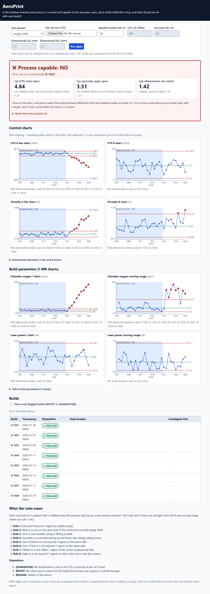

# AeroPrint

**AeroPrint tells a quality engineer, build by build, whether a 3D-printing process for titanium aerospace brackets is in control and capable of meeting the client's strength and porosity specs, and what to do with each build.**

Team AeroPrint, Cornell Six Sigma Hackathon (Virtual DL Challenge). All data in this repo is simulated.

## 1. The problem and who it is for

**Prompt:** Industrial Systems, "3D Printing for Aerospace". An aerospace contractor 3D-prints
titanium brackets (Ti-6Al-4V, laser powder-bed fusion) and keeps failing the client's strength tests.
The tool must flag **when** the process went wrong and **whether** it can meet strict tolerances, and
help the contractor fix it.

**Users:**

- **Supplier quality engineer.** Signs off each build after its 5 witness coupons come back from
  tensile and porosity testing. Decision: release the build, retest it, or quarantine it.
- **Additive manufacturing (AM) process engineer.** Uses the same screen to see which print
  parameter drifted (chamber oxygen, laser power, ...).

## 2. Live URLs

Dashboard: TODO-DASHBOARD-URL
API: TODO-API-URL

## 3. One-minute demo



The screenshot shows `oxygen_drift`: chamber oxygen creeps up from build 21, UTS falls, porosity
rises, and the tool quarantines builds B-1023 to B-1030 and points at chamber oxygen. The same
numbers come back as JSON from the API.

| Dataset (`data/`) | Process capable? | Cpl (UTS) | Cpu (porosity) | Cpk (dimensional) | First out-of-control build | Quarantined builds | Top suspect |
|---|---|---|---|---|---|---|---|
| `capable_baseline` | YES | 4.81 | 3.70 | 1.79 | none | none | none |
| `oxygen_drift` | NO | 4.64 (not reliable) | 3.51 (not reliable) | 1.42 (reliable) | B-1023 | B-1023 to B-1030 (8 builds) | chamber_oxygen_ppm (z = 9.4 at B-1023, 52.3 at B-1030) |
| `laser_power_excursion` | NO | 5.04 (not reliable) | 3.54 (not reliable) | 1.68 (not reliable) | B-1024 | B-1024, B-1025, B-1026 | laser_power_W (z = -37.0, -39.5, -37.5) |

"Not reliable" means the chart is out of control, so the index is printed but does not count.
The step-by-step walkthrough of all three datasets (with more screenshots, other spec limits and a
bad-file example) is in [`demo/README.md`](demo/README.md).

## 4. What it computes, in plain words

**Subgroup.** One build = one subgroup of exactly **5 coupons** (n = 5). Builds are put in time
order by `build_timestamp`.

**Baseline.** Control limits come from the **first 20 builds** only (`baseline_n`, default 20). We
assume those builds were running normally. Later builds are judged against those limits.

### X-bar and R charts (UTS, porosity, dimensional deviation)

An X-bar chart plots each build's mean. An R chart plots each build's range (max minus min). Using
the n = 5 constants A2 = 0.577, D3 = 0, D4 = 2.114, d2 = 2.326:

| Item | Formula |
|---|---|
| X-bar chart center line | X-double-bar = mean of the baseline build means |
| X-bar limits | X-double-bar +/- A2 x R-bar |
| R chart center line | R-bar = mean of the baseline build ranges |
| R chart limits | UCL = D4 x R-bar, LCL = D3 x R-bar = 0 |
| Within-build sigma | sigma-hat = R-bar / d2 |

### Capability (how well the process fits the spec)

All indices use the **within-build** sigma-hat = R-bar / d2. We never use the overall standard
deviation, because that gives Pp/Ppk, a different statistic.

- **Cpl** = (X-double-bar - LSL) / (3 x sigma-hat). Used for UTS, which has only a lower limit (LSL 900 MPa).
- **Cpu** = (USL - X-double-bar) / (3 x sigma-hat). Used for porosity, which has only an upper limit (USL 0.5 %).
- **Cp** = (USL - LSL) / (6 x sigma-hat). Used for dimensional deviation (two-sided, +/-0.10 mm).
- **Cpk** = min(USL - X-double-bar, X-double-bar - LSL) / (3 x sigma-hat). With one limit it is that one side.
- **Capable** = the chart is **in control** AND the index is **at least 1.33**. If the chart is out
  of control the index is still printed but marked "not reliable".
- If every coupon in the baseline is identical, sigma-hat is 0 and every index is `None` with the
  message "zero within-build variation". It is never infinity and never 0.

### I-MR charts (build parameters)

For each build parameter (laser power, scan speed, layer thickness, chamber oxygen, humidity, powder
bed temperature, build plate temperature, stress-relief temperature) there is one value per build.
An I chart plots those values. An MR chart plots the moving range (change from one build to the
next).

- Center line = mean of the baseline values. MR-bar = mean baseline moving range.
- sigma-hat = MR-bar / 1.128. Limits = center line +/- 3 sigma-hat. MR chart UCL = 3.267 x MR-bar.

### The 8 Nelson rules (run rules)

They flag patterns that are unlikely by chance. They are applied to the X-bar charts (zones use
sigma of a mean, A2 x R-bar / 3) and the I charts (zones use sigma-hat). The flag lands on the
point that completes the pattern.

| Rule | Pattern |
|---|---|
| 1 | 1 point beyond 3 sigma |
| 2 | 9 in a row on one side of the center line |
| 3 | 6 in a row steadily rising or falling |
| 4 | 14 in a row alternating up and down |
| 5 | 2 of 3 in a row beyond 2 sigma, same side |
| 6 | 4 of 5 in a row beyond 1 sigma, same side |
| 7 | 15 in a row within 1 sigma (either side) |
| 8 | 8 in a row beyond 1 sigma (either side, none within 1 sigma) |

### Build disposition (what to do with each build)

1. **QUARANTINE**: the build breaks a rule on the UTS or porosity X-bar or R chart.
2. **RETEST**: no rule is broken, but at least one coupon is outside a spec limit.
3. **RELEASE**: neither of the above.

Dimensional-deviation rules are listed for the build but do not quarantine it.

### "Investigate first"

For a flagged build, the tool lists the build parameters whose I-MR chart breaks a rule at that
build, ranked by **|z| = |x - center line| / sigma-hat**, largest first. The top one is the first
place to look. It is a ranking of charts, not a proof of cause (no regression or DOE model).

### Assumptions and limitations

- **n = 5 coupons per build.** A build with another number of coupons is refused with a clear error.
- **Baseline = the first 20 builds**, assumed to be in control. If the baseline is not in control, the limits are wrong. The baseline's own rule violations are shown.
- **Simulated data only.** The three datasets in `data/` are invented, not real aerospace data.
- **Chance alarms.** With 8 rules on many charts, an occasional false alarm is expected. Look for builds where several rules and charts agree.
- **Porosity is skewed** (it cannot go below 0), so the normality assumption is weak and its **Cpu is approximate**. A Shapiro-Wilk normality test on the baseline is reported with a warning.
- **"In control" means no rule fires anywhere in the series**, not just in the baseline.
- **One scoping choice:** the R and MR charts use **rule 1 only** (beyond the UCL). Their distribution is skewed and their LCL is 0, so the symmetric zone rules do not apply.
- Builds are assumed independent. Dimensional rules do not quarantine a build.

## 5. Inputs

One CSV, one row per coupon, 5 coupons per build, 19 columns. The full codebook (units, meaning,
how the data would be collected for real) is in [`data/README.md`](data/README.md).

| Column | Type / unit | Level | Meaning |
|---|---|---|---|
| `build_id` | text | coupon | Build number, e.g. `B-1001`. Defines the subgroup of 5. |
| `coupon_id` | text | coupon | Witness coupon id |
| `build_timestamp` | ISO 8601 datetime | coupon | When the build ran; sets the time order |
| `machine_id` | text | coupon | Printer id |
| `material_lot` | text | coupon | Powder lot |
| `uts_MPa` | MPa | coupon | Ultimate tensile strength. Spec: at least 900 |
| `yield_MPa` | MPa | coupon | Yield strength |
| `elongation_pct` | % | coupon | Elongation at break |
| `porosity_pct` | % | coupon | Porosity. Spec: at most 0.5 |
| `dimensional_dev_mm` | mm | coupon | Measured minus drawing dimension. Spec: within +/-0.10 |
| `pass_fail` | True/False | coupon | Coupon passed all specs |
| `laser_power_W` | W | build | Mean laser power (same on all 5 rows) |
| `scan_speed_mm_s` | mm/s | build | Mean scan speed |
| `layer_thickness_um` | um | build | Mean layer thickness |
| `chamber_oxygen_ppm` | ppm | build | Mean chamber oxygen |
| `humidity_pct` | % | build | Mean chamber humidity |
| `powder_bed_temp_C` | deg C | build | Mean powder bed temperature |
| `build_plate_temp_C` | deg C | build | Mean build plate temperature |
| `stress_relief_temp_C` | deg C | build | Furnace temperature of the stress-relief heat treatment |

Missing columns, empty cells (NaN), a build without exactly 5 coupons, or fewer than 2 builds give
a clear error message (HTTP 422 from the API, `ValueError` from the functions).

### Spec limits (defaults, you can change them)

| Characteristic | Column | Default limit | Target |
|---|---|---|---|
| UTS | `uts_MPa` | LSL 900 MPa | 950 |
| Porosity | `porosity_pct` | USL 0.5 % | 0.2 |
| Dimensional deviation | `dimensional_dev_mm` | LSL -0.10 mm, USL +0.10 mm | 0 |

**To change them:** on the dashboard, upload your own CSV and edit the limit boxes, then press
*Run again*. On the API, add query parameters to `POST /analyze`: `uts_lsl`, `porosity_usl`,
`dim_lsl`, `dim_usl`. In Python, pass `specs={"uts_MPa": {"lsl": 920}}` to `analyze()`. Limits you
do not give keep their defaults.

### `baseline_n`

How many of the first builds set the control limits. Default 20, minimum 5. API: `?baseline_n=10`.
Python: `analyze(df, baseline_n=10)`. If the file has fewer builds than `baseline_n`, all builds are
used and a warning says so.

## 6. How each function works

All statistics are in [`app/qc.py`](app/qc.py) as plain functions. The API and the dashboard only
call them and display the result. Inputs and errors below come from the real signatures and code.

| Function | Inputs | Parameters | Returns | Errors |
|---|---|---|---|---|
| `nelson(points, cl, sigma)` | `points`: list of numbers; `cl`: center line; `sigma`: size of one zone (1 sigma) | none | dict `{rule 1..8: [indices where the pattern completes]}` | none. If `sigma` is 0 or not a number, nothing is flagged |
| `xbar_r(df, subgroup_col, value_col, baseline_n=20)` | `df`: coupon table in time order; `subgroup_col`: the build column; `value_col`: the measurement column | `baseline_n` | dict: `build_ids`, `means`, `ranges`, `xbarbar`, `rbar`, `xbar_ucl`, `xbar_lcl`, `r_ucl`, `r_lcl`, `sigma_hat`, `sigma_xbar`, `xbar_flags` (Nelson), `r_flags` (rule 1), `baseline_n_used`, `baseline_note`, `message` | `ValueError`: missing column, NaN, `baseline_n` < 2, a build without exactly 5 coupons, fewer than 2 builds |
| `capability(xbarbar, rbar, lsl=None, usl=None, in_control=True)` | `xbarbar`: grand mean; `rbar`: mean range | `lsl`, `usl`: spec limits (at least one); `in_control`: is the chart in control | dict: `sigma_hat`, `cpl`, `cpu`, `cp`, `cpk`, `reliable`, `capable`, `message`. Unused indices are `None`. `rbar` = 0 gives all indices `None` plus a message | `ValueError`: no limit given, `usl` <= `lsl`, negative `rbar` |
| `normality(values, always_warn=None)` | `values`: baseline coupon values | `always_warn`: text always added to the warning (used for porosity) | dict `{"p_value", "warning"}` (Shapiro-Wilk; `p_value` is `None` for fewer than 3 values or constant data) | none |
| `imr(values, baseline_n=20)` | `values`: one number per build | `baseline_n` | dict: `points`, `moving_ranges`, `cl`, `mr_bar`, `sigma`, `ucl`, `lcl`, `mr_ucl`, `flags` (rules 1-8), `mr_flags` (rule 1), `baseline_n_used`, `message`. If MR-bar is 0, limits are `None` with a message | `ValueError`: fewer than 2 values, NaN, `baseline_n` < 2 |
| `disposition(rules_broken, any_out_of_spec)` | `rules_broken`: per build, a list of rule texts; `any_out_of_spec`: per build, True/False | none | list of `"QUARANTINE"`, `"RETEST"` or `"RELEASE"`, one per build | `ValueError`: the two lists differ in length |
| `rank_parameters(params_df, baseline_n=20)` | `params_df`: one row per build, in time order, one column per build parameter | `baseline_n` | dict: `charts` (I-MR per parameter), `ranking` ({build index: parameters sorted by largest abs z}), `skipped` (parameters with zero baseline sigma) | `ValueError` from `imr` (fewer than 2 builds, NaN) |
| `analyze(df, specs=None, baseline_n=20)` | `df`: coupon table with the 19 columns | `specs`: optional spec overrides; `baseline_n` | JSON-safe dict: `build_ids`, `charts`, `capability`, `process_capable`, `first_out_of_control_build`, `builds` (disposition, rules broken, investigate first), `warnings`, `settings` | `ValueError`: missing columns, NaN, bad `build_timestamp`, unknown spec column, and every error from `xbar_r` |

`analyze()` runs the others in this order: sort builds by time, X-bar/R and capability and
normality for each of UTS, porosity and dimensional deviation, I-MR and ranking for the build
parameters, then the per-build disposition table.

### Example (run from the repo root, after the setup in section 8)

```python
import pandas as pd
from app.qc import analyze

result = analyze(pd.read_csv("data/oxygen_drift.csv"))
print("process_capable:", result["process_capable"])
print("first_out_of_control_build:", result["first_out_of_control_build"])
uts = result["capability"]["uts_MPa"]
print("UTS Cpl:", round(uts["cpl"], 2), "reliable:", uts["reliable"])
build = result["builds"][22]  # the 23rd build
print(build["build_id"], build["disposition"], build["investigate_first"][0]["parameter"])
```

Output (real run):

```text
process_capable: False
first_out_of_control_build: B-1023
UTS Cpl: 4.64 reliable: False
B-1023 QUARANTINE chamber_oxygen_ppm
```

## 7. API endpoints

The API is FastAPI (`app/main.py`). It does no statistics; each route calls `analyze()`. Interactive
docs are at `/docs`. Examples assume the API is running on `http://localhost:8000` (section 8).

| Method and path | Parameters | Response |
|---|---|---|
| `GET /` | none | `{"message": "AeroPrint API is running", "docs": "/docs"}` |
| `GET /health` | none | `{"status": "ok"}` |
| `GET /datasets` | none | `{"datasets": [{"name", "description"}, ...]}` (the 3 bundled files) |
| `GET /spec-limits` | none | `{"specs": {column: {"lsl", "usl", "target"}}}` |
| `GET /analyze/{dataset}` | path: dataset name; query: `baseline_n` (>= 5, default 20) | the full `analyze()` result. 404 for an unknown name |
| `POST /analyze` | form file `file` (CSV); query: `baseline_n` (>= 5, default 20), `uts_lsl`, `porosity_usl`, `dim_lsl`, `dim_usl` | the full `analyze()` result. 422 `{"detail": "..."}` for bad input |

```bash
curl http://localhost:8000/health
# {"status":"ok"}

curl http://localhost:8000/datasets
# {"datasets":[{"name":"capable_baseline","description":"30 builds, process in control; ..."}, ...]}

curl http://localhost:8000/spec-limits
# {"specs":{"uts_MPa":{"lsl":900.0,"usl":null,"target":950.0},"porosity_pct":{"lsl":null,"usl":0.5,"target":0.2},"dimensional_dev_mm":{"lsl":-0.1,"usl":0.1,"target":0.0}}}

curl http://localhost:8000/analyze/oxygen_drift
# JSON with keys: build_ids, charts, capability, process_capable, first_out_of_control_build, builds, warnings, settings
# (process_capable false, first_out_of_control_build "B-1023")

curl -F file=@data/laser_power_excursion.csv http://localhost:8000/analyze
# same JSON shape for your own file

curl -F file=@data/oxygen_drift.csv "http://localhost:8000/analyze?baseline_n=20&uts_lsl=990"
# same JSON shape, UTS Cpl is now -1.04 because the lower limit is 990

curl -F file=@bad.csv http://localhost:8000/analyze     # a CSV with columns a,b only
# {"detail":"missing required columns: build_id, coupon_id, ..."}   (HTTP 422)
```

Each `builds` entry looks like this (real output for B-1023 of `oxygen_drift`):

```json
{"build_id": "B-1023", "timestamp": "2026-02-18T08:00:00", "disposition": "QUARANTINE",
 "any_coupon_out_of_spec": false, "rules_broken": ["uts X-bar rule 1", "uts X-bar rule 5"],
 "investigate_first": [{"parameter": "chamber_oxygen_ppm", "z": 9.438, "rules": [1, 5]}]}
```

## 8. How to run it in one command from a fresh clone

You need **Python 3.11 or newer** (tested on 3.13 and 3.15) and, for the dashboard, **Node.js 20 or newer**.
Run everything from the repo root. `bash` on Windows means Git Bash (it comes with Git).

```bash
git clone https://github.com/sean-zhen674/six-sigma-hackathon-sean-sam-parker.git
cd six-sigma-hackathon-sean-sam-parker
```

**Step 1. Make a virtual environment and install the packages (once).**

Windows (Git Bash or PowerShell):

```bash
python -m venv .venv
.venv/Scripts/python.exe -m pip install -r app/requirements.txt -r app/requirements-dev.txt
```

macOS / Linux:

```bash
python3 -m venv .venv
.venv/bin/python -m pip install -r app/requirements.txt -r app/requirements-dev.txt
```

(You can also activate the environment first, then use plain `pip install ...`.)

**Step 2. Start the API (the one command).**

```bash
bash app/testme.sh
```

It finds `.venv` by itself and serves the API at http://localhost:8000 (docs at
http://localhost:8000/docs). This alone is enough to use the tool: `/docs` is a working front end.
Stop it with Ctrl+C.

**Step 3. Start the dashboard (second terminal, optional).**

```bash
cd app/frontend
npm install
npm run dev
```

Open http://localhost:5173. The page finds the API at `http://localhost:8000` (set in
`app/frontend/src/config.js`).

### Tests

```bash
python -m pytest tests -q          # Python: statistics and API (use .venv/Scripts/python.exe on Windows if the venv is not active)
cd app/frontend && npm test        # React: formatting and axis helpers
```

## 9. Repository map

```text
README.md              this file
SPEC.md                what the tool is and the statistics (the spec)
CONTRACT.yaml          task ledger (who built what, and how it was checked)
app/qc.py              ALL the statistics (plain functions)
app/main.py            FastAPI routes; they only call qc.py
app/README.md          short API notes and Posit Connect bundling
app/testme.sh          start the API locally
app/manifestme.sh      write manifest.json for Posit Connect
app/deployme.sh        deploy the API from your machine
app/requirements*.txt  Python packages (runtime and tests)
app/frontend/          React (Vite) dashboard; draws what the API returns
data/                  3 simulated CSV datasets, generate.py, codebook (data/README.md)
demo/                  walkthrough (demo/README.md) and screenshots
tests/                 pytest tests: known answers, degenerate cases, API
docs/                  hackathon event pages (criteria, schedule, ...)
demos/                 hackathon starter templates we copied from
```

## 10. Deploy notes

The tool runs on the course Posit Connect server as two pieces: first the API (`app/`), then the
static React build (`app/frontend/`), built with `VITE_API_BASE=<API URL>` so it calls the deployed
API. A GitHub Actions workflow (task H-06) is meant to redeploy on each push. The secrets `CONNECT_SERVER` and
`CONNECT_API_KEY` are GitHub repo secrets (or a gitignored `.env` for a local deploy); they are
never written in any file in this repo. Details of bundling are in [`app/README.md`](app/README.md).

## 11. Credits and citations

- **SYSEN 5300 textbook** (Timothy Fraser, Cornell): <https://timothyfraser.com/sigma/>, for X-bar/R, I-MR and capability methods.
- **Nelson, L. S. (1984).** "The Shewhart Control Chart: Tests for Special Causes." *Journal of Quality Technology* 16(4): the 8 run rules.
- **Montgomery, D. C.** *Introduction to Statistical Quality Control*: control chart constants (A2, D3, D4, d2 for n = 5; 1.128 and 3.267 for moving ranges of 2).
- **Starter templates** from the hackathon repo (`demos/fastapi`, `demos/reactfront`), copied into `app/` and `app/frontend/` and then changed.
- **AI assistance:** built with Claude Code (Anthropic). Every statistic was checked against hand calculations (the known answers in `SPEC.md` section 4) and an independent review. The team reads and can explain every number the tool prints.

## 12. Event links

- [Evaluation criteria](docs/criteria.md)
- [Schedule](docs/schedule.md)
- [Prompts](docs/prompts.md)
- [Demo walkthrough](demo/README.md)
- [Test data codebook](data/README.md)
- [SPEC](SPEC.md)
