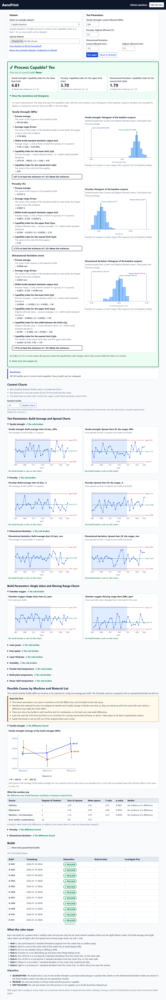
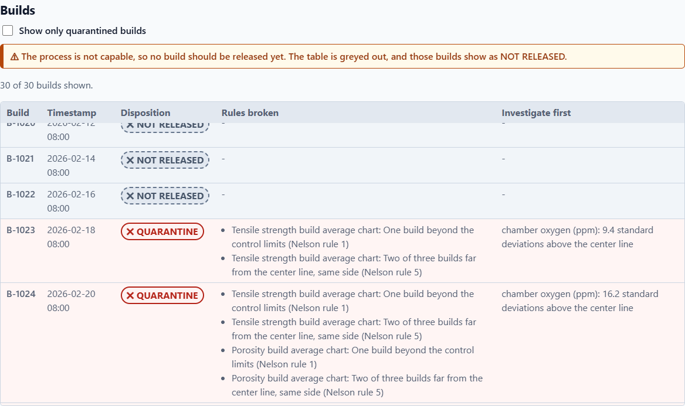
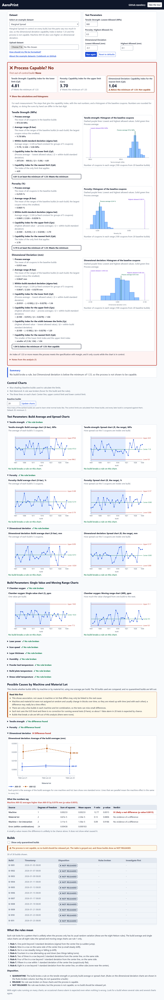
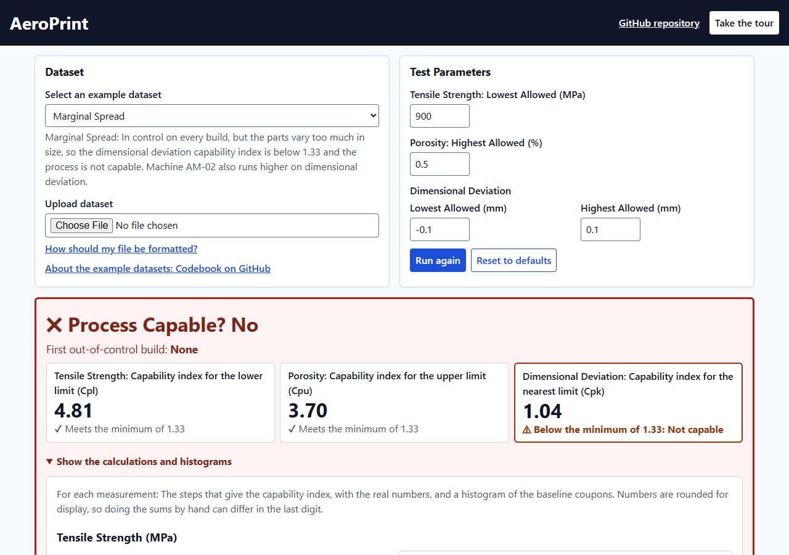
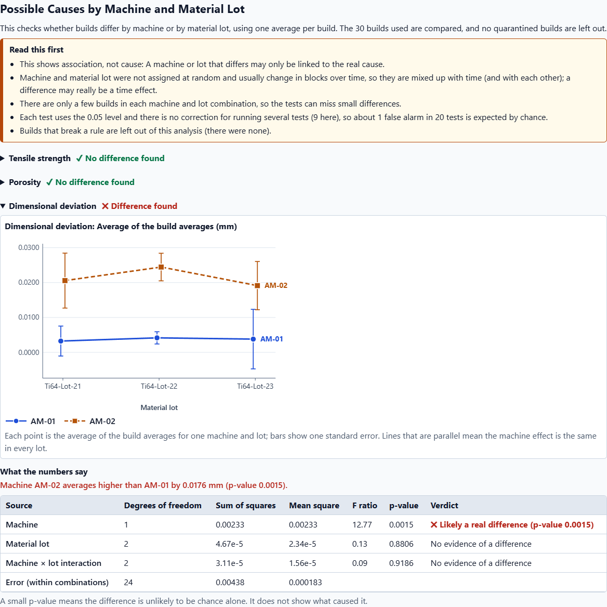
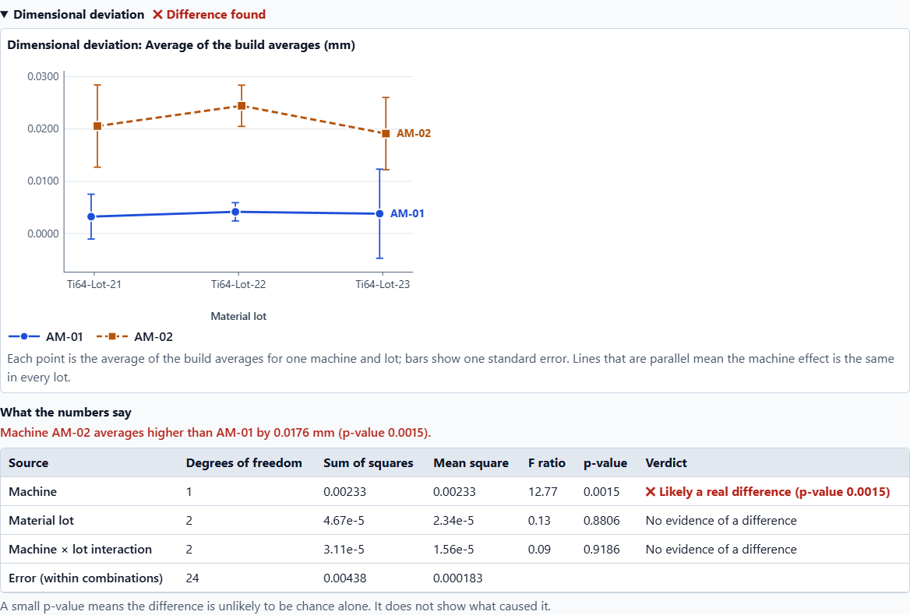
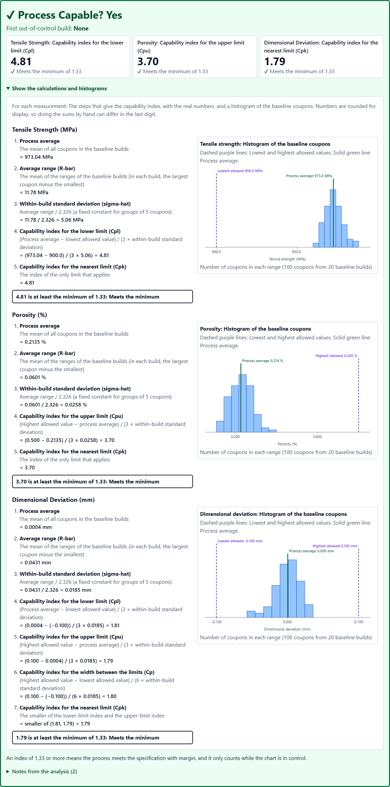
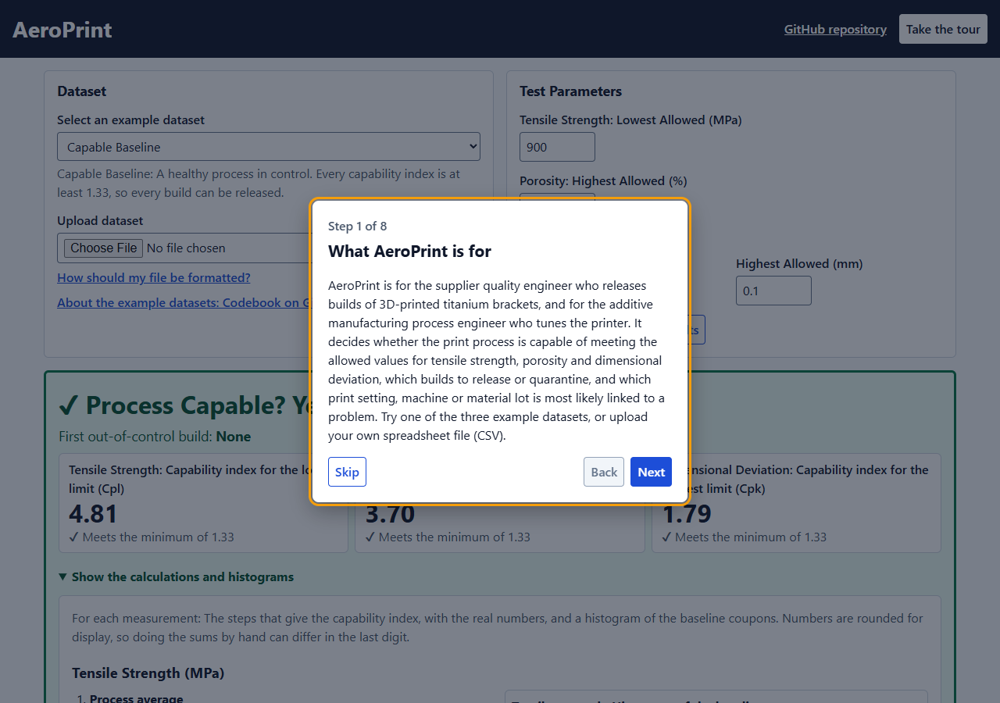
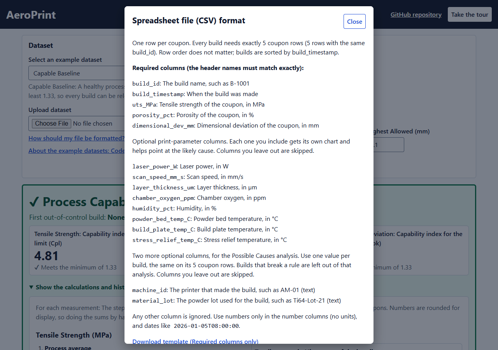

# AeroPrint

**AeroPrint tells a quality engineer, build by build, whether a 3D-printing process for titanium aerospace brackets is in control and capable of meeting the client's strength, porosity and size limits, and what to do with each build.**


*The dashboard on the `oxygen_drift` example: the process is not capable, the first alarm is build B-1023, and chamber oxygen is the first thing to investigate.*

| | |
|---|---|
| **Live dashboard** | <https://connect.systems-apps.com/content/a5702adb-d4c3-4cbc-8856-737753cfd9d2/> |
| **Live API and its interactive docs** | <https://connect.systems-apps.com/content/8ec33f65-f84a-4323-a51d-b2d9a70e08da/docs> |
| **Repository** | <https://github.com/sean-zhen674/six-sigma-hackathon-sean-sam-parker> |
| **Team** | AeroPrint |
| **Event** | Cornell Six Sigma Hackathon, Virtual DL Challenge (Distance Learning track) |
| **Prompt** | Prompt 1, Industrial Systems: "3D Printing for Aerospace". An aerospace contractor 3D-printing titanium brackets is failing client strength tests; design a tool to monitor and flag when and whether the printing process is capable of meeting strict aerospace tolerances, and help contractors resolve these issues. |

All data in this repository is **simulated** (invented). It is shaped like real field data, but it is not real customer or aerospace data.

## Table of contents

1. [Who it is for and what it decides](#1-who-it-is-for-and-what-it-decides)
2. [See it in 2 minutes: the three test datasets](#2-see-it-in-2-minutes-the-three-test-datasets)
3. [Run it yourself](#3-run-it-yourself)
4. [Using the dashboard](#4-using-the-dashboard)
5. [Input data](#5-input-data)
6. [The method](#6-the-method)
7. [Python library reference](#7-python-library-reference)
8. [REST API reference](#8-rest-api-reference)
9. [Dashboard code map and architecture](#9-dashboard-code-map-and-architecture)
10. [Repository layout, deployment and reproducibility](#10-repository-layout-deployment-and-reproducibility)
11. [Assumptions, limitations and known gaps](#11-assumptions-limitations-and-known-gaps)
12. [Datasets](#12-datasets)
13. [Credits and references](#13-credits-and-references)

## 1. Who it is for and what it decides

**The problem.** A contractor 3D-prints brackets in titanium (Ti-6Al-4V, laser powder-bed fusion). The client keeps failing the contractor's parts on strength tests. The contractor needs to know **when** the process went wrong and **whether** it can meet the client's limits at all.

**The users.**

| Person | What they do | What AeroPrint gives them |
|---|---|---|
| **Supplier quality engineer** | Signs off each build after its 5 witness coupons (small test pieces printed in the same build) come back from tensile and porosity testing. | A verdict for every build: RELEASE, QUARANTINE or NOT RELEASED. A yes or no on "is the process capable?". |
| **Additive manufacturing (AM) process engineer** | Tunes the printer. | Which print setting drifted first (chamber oxygen, laser power, and so on), and whether a machine or a material lot is linked to a shift. |

**The decisions it supports**, each time a build's coupon results arrive and before the parts ship:

1. **Is the process capable** of meeting the allowed values for tensile strength (MPa), porosity (%) and dimensional deviation (mm)?
2. **Which builds to release and which to quarantine**, and from which build the process stopped behaving like the baseline.
3. **Which print setting to investigate first** for a flagged build.
4. **Is a machine or a material lot linked to a problem?** (An association, not a proof of cause.)

**Minimal inputs.** One CSV file with **5 columns** and 5 rows per build. Everything else (eight print settings, machine, lot) is optional. See [section 5](#5-input-data).

## 2. See it in 2 minutes: the three test datasets

Three simulated files live in [`data/`](data/). Each is 30 builds of 5 coupons (150 rows) and shows one behaviour. The codebook for every file and column (units, ranges, how the data would be collected for real, the simulation seeds) is [`data/README.md`](data/README.md). A click-by-click walkthrough with more screenshots is [`demo/README.md`](demo/README.md).

| Dataset | What it shows | Process capable? | Cpl (tensile strength) | Cpu (porosity) | Cpk (dimensional) | First alarm | Verdicts for the 30 builds |
|---|---|---|---|---|---|---|---|
| `capable_baseline` | A healthy process in control | **Yes** | 4.81 | 3.70 | 1.79 | none | 30 RELEASE |
| `oxygen_drift` | Chamber oxygen creeps up from build 21 | **No** | 4.64 (not reliable) | 3.51 (not reliable) | 1.42 | B-1023 | 8 QUARANTINE (B-1023 to B-1030) and 22 NOT RELEASED |
| `marginal_spread` | In control on every chart, but the dimensional spread is too wide | **No** | 4.81 | 3.70 | **1.04** (below 1.33) | none | **30 NOT RELEASED**. No build is released. |

All numbers use the default settings (baseline of 20 builds, default allowed values). "Not reliable" means that chart is out of control, so the index is printed but does not count. You can re-derive every number in the table with the script at the end of this section.

### 2.1 `capable_baseline`: a healthy process

Open the dashboard (it starts on this dataset). The banner says **Process Capable? Yes**. No red diamonds. All 30 builds show RELEASE.



*`capable_baseline`: the banner says Yes; the indices are 4.81, 3.70 and 1.79, all well above the minimum of 1.33.*

### 2.2 `oxygen_drift`: find when it went wrong and why

Pick **Oxygen Drift** in the Dataset box. Chamber oxygen rises steadily from build 21 (from about 100 ppm to 421.9 ppm at B-1030), so tensile strength falls and porosity rises.

- The banner says **Process Capable? No**. The first out-of-control build is **B-1023**.
- The tensile strength and porosity charts show red diamonds from B-1023 (tensile strength X-bar chart rules 1 and 5 at B-1023, rule 3 first at B-1025, rule 2 at B-1030). The chamber oxygen chart shows its own alarms.
- The Builds table lists **8 QUARANTINE** builds, B-1023 to B-1030. "Investigate first" says **chamber oxygen** for every one: 9.4 standard deviations above its center line at B-1023 and 52.3 at B-1030.
- The other 22 builds (B-1001 to B-1022) show NOT RELEASED. They broke no rule, but the process is not capable, so none is released.
- The Possible Causes section leaves the 8 quarantined builds out, so the oxygen drift is not blamed on a machine or a lot.


*`oxygen_drift`: the banner and the charts.*



*The Builds table on `oxygen_drift`.*

### 2.3 `marginal_spread`: in control, but not capable

Pick **Marginal Spread**. Every build is in control on every chart (no red diamond anywhere), but the dimensional deviation varies too much for the plus or minus 0.10 mm limits.

- The banner says **Process Capable? No**. Cpk for dimensional deviation is **1.04**, below the minimum of 1.33. Cp is 1.20.
- The process average of the dimensional deviation is 0.0131 mm and the within-build standard deviation (sigma-hat) is 0.0278 mm.
- **No build may be released.** Since the process is not capable, all 30 builds show **NOT RELEASED**. This is also what the API says: the `disposition` of every build is `NOT RELEASED`.
- **A planted, disclosed machine effect.** In this file only, every coupon printed on machine AM-02 has a constant **+0.025 mm** added to its dimensional deviation. The Possible Causes section finds it: machine effect on dimensional deviation, F = 12.77, **p = 0.0015** (AM-01 averages 0.0037 mm, AM-02 averages 0.0214 mm). It is put there on purpose so the analysis has something to find. Its size was chosen after a scan, only to be large enough to detect with 5 builds per combination while raising no control-chart alarm. Tensile strength and porosity show nothing (all p-values above 0.17). The disclosure is repeated in [`data/README.md`](data/README.md).



*`marginal_spread`: in control, but not capable.*



*The banner on `marginal_spread`: the dimensional Cpk is below the minimum.*



*The Possible Causes section on `marginal_spread`.*



*The interaction plot for dimensional deviation: AM-02 sits above AM-01 in every lot, and the lines are roughly parallel (no interaction).*

### 2.4 Open the calculations and take the tour

The Process Capable box has a toggle, **Show the calculations and histograms**, open by default. For every measurement it shows each step of the index with the real numbers, and a histogram of the baseline coupons with the allowed values (dashed lines) and the process average (solid line).



*The calculation steps and the histograms.*

The **Take the tour** button in the header opens an 8-step guided tour (it also opens by itself on a first visit). Its last step sends you to this README.



*Tour step 1.*

### 2.5 Re-derive the table yourself

Run from the repo root after the setup in [section 3](#3-run-it-yourself). In an interactive Python prompt (run `.venv\Scripts\python.exe` on Windows), paste:

```python
from collections import Counter
import pandas as pd
from app.qc import analyze

for name in ["capable_baseline", "oxygen_drift", "marginal_spread"]:
    r = analyze(pd.read_csv(f"data/{name}.csv"))
    cap = r["capability"]
    print(name)
    print("  process_capable:", r["process_capable"], "| first alarm:", r["first_out_of_control_build"])
    print("  Cpl %.2f  Cpu %.2f  Cpk %.2f" % (cap["uts_MPa"]["cpl"], cap["porosity_pct"]["cpu"], cap["dimensional_dev_mm"]["cpk"]))
    print("  dispositions:", dict(Counter(b["disposition"] for b in r["builds"])))
    dim = r["factors"]["metrics"]["dimensional_dev_mm"]["anova"]["machine"]
    print("  machine effect on dimensional deviation: p = %.4f" % dim["p"])
```

Real output:

```text
capable_baseline
  process_capable: True | first alarm: None
  Cpl 4.81  Cpu 3.70  Cpk 1.79
  dispositions: {'RELEASE': 30}
  machine effect on dimensional deviation: p = 0.1540
oxygen_drift
  process_capable: False | first alarm: B-1023
  Cpl 4.64  Cpu 3.51  Cpk 1.42
  dispositions: {'NOT RELEASED': 22, 'QUARANTINE': 8}
  machine effect on dimensional deviation: p = 0.1021
marginal_spread
  process_capable: False | first alarm: None
  Cpl 4.81  Cpu 3.70  Cpk 1.04
  dispositions: {'NOT RELEASED': 30}
  machine effect on dimensional deviation: p = 0.0015
```

(In `capable_baseline` and `oxygen_drift` the machine p-values are not significant at 0.05.)

## 3. Run it yourself

**Prerequisites.**

| Tool | Version | Used for |
|---|---|---|
| Python | 3.12 or newer (the deployed API uses 3.12; the local checks in this repo ran on 3.12.10 and 3.15.0) | the statistics library, the API, the tests |
| Node.js | 20 or newer (the deploy workflow builds with 22; the local checks ran on 24) | the dashboard |
| Git | any | cloning. On Windows its Git Bash also runs the `.sh` scripts |

Run every command from the repository root unless it says otherwise.

### 3.1 Get the code and install

```powershell
git clone https://github.com/sean-zhen674/six-sigma-hackathon-sean-sam-parker.git
cd six-sigma-hackathon-sean-sam-parker
python -m venv .venv
.venv\Scripts\python.exe -m pip install -r app/requirements.txt -r app/requirements-dev.txt
```

Git Bash on Windows (same thing with forward slashes):

```bash
python -m venv .venv
.venv/Scripts/python.exe -m pip install -r app/requirements.txt -r app/requirements-dev.txt
```

macOS or Linux:

```bash
python3 -m venv .venv
.venv/bin/python -m pip install -r app/requirements.txt -r app/requirements-dev.txt
```

`app/requirements.txt` holds the packages the API needs (all versions pinned). `app/requirements-dev.txt` adds `pytest` and `httpx` for the tests.

### 3.2 Start the API

One command (it finds `.venv` by itself and serves on port 8000):

```bash
bash app/testme.sh
```

The same thing by hand:

```powershell
.venv\Scripts\python.exe -m uvicorn app.main:app --port 8000
```

Open <http://localhost:8000/docs> for the interactive API page. The API alone is enough to use the tool. Stop it with Ctrl+C.

### 3.3 Start the dashboard (second terminal)

```powershell
cd app\frontend
npm install
npm run dev
```

Open <http://localhost:5173>. The page looks for the API at `http://localhost:8000` (see [`app/frontend/src/config.js`](app/frontend/src/config.js)). To point it somewhere else, set `VITE_API_BASE` (see [`app/frontend/README.md`](app/frontend/README.md)).

### 3.4 Run the tests

```powershell
.venv\Scripts\python.exe -m pytest tests -q
cd app\frontend
npm test
```

Expected: **138 passed** (Python) and **172 passed** (JavaScript, 7 test files).

### 3.5 Build the dashboard for production

```powershell
cd app\frontend
npm run build
```

This writes a static site into `app/frontend/dist/`. `npm run preview` serves it locally.

### 3.6 Check your setup in one minute

With the API running, upload [`data/template/aeroprint_template.csv`](data/template/aeroprint_template.csv) in the dashboard. Tensile strength Cpl must come out as **3.88** (3.877 from the API). That is the hand calculation in [section 6.12](#612-worked-example-you-can-reproduce-by-hand).

## 4. Using the dashboard

The page has these parts, top to bottom. Every number on it comes from the API; the page only draws it (see [section 9](#9-dashboard-code-map-and-architecture)).

**Header.** The title, a link to the GitHub repository, and the **Take the tour** button. Below the header, on a screen narrower than 500 px, a note warns that the charts are small.

### 4.1 Dataset box

| Control | What it does |
|---|---|
| **Select an example dataset** | Picks one of the three bundled datasets (Capable Baseline, Oxygen Drift, Marginal Spread). The analysis runs at once, and the four allowed values go back to their defaults. A line under the box describes the dataset. |
| **Upload dataset** | Choose your own CSV. It is analysed at once. A line says "Analyzing your file ..." while it replaces the example. |
| **How should my file be formatted?** | Opens a window listing the required and optional columns with two template CSVs to download (the files are copies of [`data/template/`](data/template/)). |
| **About the example datasets: Codebook on GitHub** | Opens [`data/README.md`](data/README.md). |



*The file-format window.*

### 4.2 Test Parameters box

Here "test parameters" means the four **allowed values** (specification limits) the measurements are compared with.

| Box | Default | Meaning |
|---|---|---|
| Tensile Strength: Lowest Allowed (MPa) | 900 | lower limit of tensile strength |
| Porosity: Highest Allowed (%) | 0.5 | upper limit of porosity |
| Dimensional Deviation: Lowest Allowed (mm) | -0.10 | lower limit of dimensional deviation |
| Dimensional Deviation: Highest Allowed (mm) | 0.10 | upper limit of dimensional deviation |

- **Run again** sends the analysis again with the numbers in the boxes. A blank box means "use the default".
- **Reset to defaults** puts the four allowed values back and sets Baseline builds back to 20.
- If a box is not a number, or the lowest dimensional value is not below the highest, a red message "Check the allowed values" appears and nothing is sent.

### 4.3 The Process Capable box (banner)

- **Process Capable? Yes / No.** Yes only when every chart is in control and every index is at least 1.33 (see [6.5](#65-the-capable-rule)).
- **First out-of-control build**, or "None".
- **Three index rows**: tensile strength Cpl, porosity Cpu, dimensional deviation Cpk. Under each number: "Meets the minimum of 1.33", "Below the minimum of 1.33: Not capable", or a warning "Chart out of control" (the number is printed but does not count).
- **Show the calculations and histograms** (open by default). For each measurement: the process average, the average range (R-bar), sigma-hat = R-bar / 2.326, then the indices as they exist, with the real numbers; and a histogram of the individual baseline coupons with dashed lines at the allowed values and a solid line at the process average.
- **Notes from the analysis (n)**: the warnings from the API (for example "porosity is bounded at 0 and skewed, so Cpu is approximate").
- The sentence "An index of 1.33 or more means the process meets the specification with margin, and it only counts while the chart is in control."

### 4.4 Summary box

One or two sentences, for example "From build B-1023 the process went out of control; 8 builds should be quarantined. Most likely cause: Chamber oxygen (ppm)."

### 4.5 Control Charts

Reading guide at the top: **blue shading** marks the baseline builds used for the limits; a **red diamond** is a build that broke a rule; each chart has three lines (center line, upper and lower control limit).

- **Baseline builds** box (with an **Update charts** button; Enter or leaving the box also applies it): how many of the earliest builds set the limits. Default 20, minimum 3. A yellow caution appears below 10 builds because the limits are then rough.
- **Test Parameters: Build Average and Spread Charts.** One drop-down row each for Tensile strength (MPa), Porosity (%) and Dimensional deviation (mm). Each row has two charts: the build average chart (X-bar) and the spread chart (R). The row heading says "Rule broken" or "No rule broken" even when closed.
- **Build Parameters: Single Value and Moving Range Charts.** One row per print setting present in the file (chamber oxygen and laser power first), each with a single value chart (I) and a moving range chart (MR). Without setting columns the section says so and the likely cause is not ranked.
- **Hover or tap a point** to see the build, the value with its unit and the rules it broke. (Point values are mouse and touch only; the chart's text summary for screen readers lists the flagged builds.)
- **Under each chart**, a list names each broken rule in plain words with the builds that broke it.

### 4.6 Possible Causes by Machine and Material Lot

Shown when the file has `machine_id` and/or `material_lot`. Without them, one short note and a link to the file-format window.

- Two intro sentences and a **Read this first** list (association is not cause; machine and lot are mixed up with time; few builds per combination; no correction for 9 tests; quarantined builds are left out).
- One drop-down per measurement with a status: **Difference found** (red), **No difference found** (green) or **Not tested**. The measurement with a significant effect opens first.
- Inside: an **interaction plot** (one line per machine across the lots; bars are one standard error), a plain sentence such as "Machine AM-02 averages higher than AM-01 by 0.0176 mm (p-value 0.0015).", and the **ANOVA table** (degrees of freedom, sums of squares, mean squares, F, p-value, and a verdict from the API: "Likely a real difference", "No evidence of a difference" or "Not tested").

### 4.7 Builds table

| Column | Meaning |
|---|---|
| Build | the build id |
| Timestamp | when it ran |
| Disposition | **QUARANTINE**, **NOT RELEASED** or **RELEASE**, exactly as the API says |
| Rules broken | the rules the build broke, in words |
| Investigate first | the print setting that moved the most at this build, for example "chamber oxygen (ppm): 9.4 standard deviations above the center line" |

The checkbox **Show only quarantined builds** filters the rows. When the process is not capable the table is greyed out with a note above it.

### 4.8 What the rules mean

The eight Nelson rules in plain words ([section 6.8](#68-the-8-nelson-rules)) and the three verdicts:

| Verdict | Meaning |
|---|---|
| **QUARANTINE** | The build broke a rule on the tensile strength or porosity build average or spread chart. (Rules on the dimensional charts are listed but do not quarantine.) |
| **NOT RELEASED** | No rule was broken, but the process is not capable, so no build should be released yet. |
| **RELEASE** | No rule was broken and the process is capable. |

**What NOT RELEASED means.** It is not a judgement that this particular build is bad. It says the process as a whole cannot yet be shown to meet the specification with margin, so nobody should release builds from it. A build with a broken rule always stays QUARANTINE.

### 4.9 The guided tour

**Take the tour** opens 8 steps: What AeroPrint is for; Pick your data; Read the banner; See the calculations; Find the red diamonds; Look for possible causes; Act on each build; Read the full documentation (this README). A step with a target scrolls to it and outlines it. It opens by itself on the first visit; the browser remembers that it was seen. A picture of step 1 is in [section 2.4](#24-open-the-calculations-and-take-the-tour).

## 5. Input data

One CSV, **one row per coupon**, **exactly 5 coupons per build**. The full guide (formatting rules, a worked example, how many builds you need, common errors) is [`docs/csv-format.md`](docs/csv-format.md). Templates: [5 columns](data/template/aeroprint_template.csv) and [with the 8 print settings](data/template/aeroprint_template_with_parameters.csv).

### 5.1 Required columns (5)

| Column | Type and unit | Meaning |
|---|---|---|
| `build_id` | text | Build number, for example `B-1001`. The 5 rows with the same id are one build. |
| `build_timestamp` | ISO 8601 date and time, for example `2026-01-05T08:00:00` | When the build ran. Builds are put in time order by this. |
| `uts_MPa` | number, MPa | Ultimate tensile strength of one coupon. Default limit: at least 900. |
| `porosity_pct` | number, % | Porosity of one coupon. Default limit: at most 0.5. |
| `dimensional_dev_mm` | number, mm | Measured size minus drawing size of one coupon (can be negative). Default limits: -0.10 to +0.10. |

### 5.2 Optional print-setting columns (8)

Each one present gets its own I-MR chart and joins "investigate first". Absent ones are skipped and listed in `settings.parameters_missing` (with a warning). The best is the same value on all 5 rows of a build; if it differs between rows, the build's value is the mean of its rows.

| Column | Unit | Meaning |
|---|---|---|
| `laser_power_W` | W | Laser power |
| `scan_speed_mm_s` | mm/s | Scan speed |
| `layer_thickness_um` | µm | Layer thickness |
| `chamber_oxygen_ppm` | ppm | Oxygen in the build chamber |
| `humidity_pct` | % | Humidity in the chamber |
| `powder_bed_temp_C` | °C | Powder bed temperature |
| `build_plate_temp_C` | °C | Build plate temperature |
| `stress_relief_temp_C` | °C | Furnace temperature of the stress-relief heat treatment |

A setting that never changes in the baseline cannot be charted (no spread to measure); it is skipped with a warning.

### 5.3 Optional machine and lot columns (2)

`machine_id` and `material_lot`: text, **one value per build** (the same on its 5 rows), read with spaces trimmed (capital letters matter). They feed the Possible Causes analysis. A blank, mixed-within-a-build or single-level column is skipped with a message (`factors.skipped`), never an error. Absent ones are listed in `settings.factors_missing`.

### 5.4 Ignored columns

Any other column (`coupon_id`, `yield_MPa`, `elongation_pct`, `pass_fail`, notes, ...) is **never read**, so blanks or text in it cannot cause an error.

### 5.5 Allowed values (specification limits) and baseline

| Setting | Default | Dashboard | API query parameter | Python |
|---|---|---|---|---|
| Tensile strength lower limit | 900 MPa (target 950) | Test Parameters box | `uts_lsl` | `specs={"uts_MPa": {"lsl": 920}}` |
| Porosity upper limit | 0.5 % (target 0.2) | Test Parameters box | `porosity_usl` | `specs={"porosity_pct": {"usl": 0.4}}` |
| Dimensional lower and upper limit | -0.10 and +0.10 mm (target 0) | Test Parameters box | `dim_lsl`, `dim_usl` | `specs={"dimensional_dev_mm": {"lsl": -0.08, "usl": 0.08}}` |
| Baseline builds | 20, minimum 3 (API and page), caution below 10 | Baseline builds box | `baseline_n` | `baseline_n=10` |

Limits you do not give keep their defaults. Tensile strength has only a lower limit and porosity only an upper limit; you cannot add the other side.

### 5.6 Errors you may see

A file the tool cannot use gives a clear message. In the API it is an HTTP 422; in Python it is a `ValueError`. The dashboard adds a plain-English hint above the raw message. Real messages:

| Message | Fix |
|---|---|
| `missing required columns: uts_MPa` | Add the column, or rename it to the exact name. |
| `build B-1001 has 4 coupons; each build needs exactly 5 coupons` | Add or remove rows so each build has 5. |
| `column 'uts_MPa' has non-numeric text, for example '950 MPa' in row 5 of the file; use plain numbers without units` | Put the plain number in the cell. Row 1 is the header. |
| `column 'porosity_pct' has 1 blank or missing values (first in row 3 of the file); fill them in or delete those rows` | Fill the empty cell. |
| `build_timestamp is not a valid date/time (for example 'last Tuesday'); use a form like 2026-01-05T08:00:00` | Use the ISO form. |
| `need at least 2 builds to draw a control chart` | Add more builds (20 or more is best). |
| `the file has a header but no data rows` | Add the coupon rows. |
| `column 'uts_MPa' appears 2 times in the header; keep only one` | Remove the duplicate. |
| `usl must be greater than lsl` | The lowest allowed value must be below the highest. |

More messages (infinite values, True/False, dates in a number column, unreadable file) are listed in [`docs/csv-format.md`](docs/csv-format.md#10-common-errors).

## 6. The method

### 6.1 Subgroups: one build is one subgroup

The 5 witness coupons of one build are a **subgroup** (n = 5). Within a build the coupons were made together, so the spread inside a build shows the process's usual random variation. Differences **between** builds are what the charts look for. Builds are sorted by `build_timestamp`.

### 6.2 The baseline

Control limits and the process average come from the first N builds in time order, the **baseline** (default N = 20, minimum 3 on the page and API; a caution appears below 10). We assume those builds ran normally. Every later build is judged against those limits. If the file has fewer builds than N, all builds are used and a warning says so.

**Why not the whole file?** If the problem is inside the baseline, the limits absorb it and the alarm never fires where it should. With `oxygen_drift` (the oxygen creeps up from build 21):

| Baseline | First alarm | Verdicts |
|---|---|---|
| 20 builds (default) | B-1023 | 8 QUARANTINE, 22 NOT RELEASED |
| all 30 builds | B-1002 | 28 QUARANTINE, 2 NOT RELEASED |

With all 30 builds the drifting builds are treated as "normal", so the center lines and limits are worked out from drifted data. The earliest alarm is then B-1002 (a porosity rule 1 alarm against the shifted limits), long before the drift starts at build 21, and 28 of 30 builds are quarantined. A good baseline is a stretch when you know the process was normal. The opposite problem also exists: with a baseline of only 6 builds, even the healthy `capable_baseline` file raises false alarms (first at B-1006, 4 builds quarantined), because 6 builds give very rough limits. That is why the page cautions below 10.

### 6.3 X-bar and R charts (tensile strength, porosity, dimensional deviation)

Constants for n = 5 (Montgomery): **A2 = 0.577, D3 = 0, D4 = 2.114, d2 = 2.326**.

| Item | Formula |
|---|---|
| X-bar (build average) of a build | mean of its 5 coupons |
| R (range) of a build | largest coupon minus smallest coupon |
| X-double-bar (process average) | mean of the baseline build averages |
| R-bar (average range) | mean of the baseline build ranges |
| X-bar chart center line | X-double-bar |
| X-bar chart limits | X-double-bar plus or minus A2 x R-bar |
| R chart center line | R-bar |
| R chart limits | UCL = D4 x R-bar, LCL = D3 x R-bar = 0 |
| Within-build standard deviation (sigma-hat) | R-bar / d2 |
| Standard deviation of a build average (sigma of X-bar) | sigma-hat / sqrt(5) = A2 x R-bar / 3 |

### 6.4 Capability indices

All indices use the **within-build** sigma-hat = R-bar / d2. We never use the overall standard deviation of all coupons, because that gives Pp and Ppk, a different statistic.

| Index | Formula | Used for |
|---|---|---|
| **Cpl** | (X-double-bar - LSL) / (3 x sigma-hat) | tensile strength (only a lower limit, LSL 900 MPa) |
| **Cpu** | (USL - X-double-bar) / (3 x sigma-hat) | porosity (only an upper limit, USL 0.5 %) |
| **Cp** | (USL - LSL) / (6 x sigma-hat) | dimensional deviation (two limits, +/-0.10 mm) |
| **Cpk** | min(USL - X-double-bar, X-double-bar - LSL) / (3 x sigma-hat) | dimensional deviation; with one limit it is that one side |

Degenerate case: if every coupon in a build is identical in every baseline build, R-bar is 0, sigma-hat is 0 and the indices are **undefined**: they come back as `None` with the message "zero within-build variation: capability indices are undefined". They are never infinity and never 0.

### 6.5 The capable rule

A measurement is **capable** when its chart is **in control** (no rule broken on any build of that measurement) **and** its index is **at least 1.33**. The process is capable (**Process Capable? Yes**) when every charted characteristic (tensile strength, porosity and dimensional deviation) is capable. If a chart is out of control, its index is still printed but marked **not reliable** (`reliable` is false). The minimum 1.33 is the constant `CAPABLE_MIN`.

### 6.6 I-MR charts (print settings)

Each print setting has one value per build. The **I chart** plots those values. The **MR chart** plots the moving range, the change from one build to the next.

| Item | Formula |
|---|---|
| Center line | mean of the baseline values |
| MR-bar | mean of the baseline moving ranges |
| sigma-hat | MR-bar / 1.128 |
| I chart limits | center line plus or minus 3 x sigma-hat |
| MR chart upper limit | 3.267 x MR-bar |

### 6.7 Where the rules apply

The eight Nelson rules apply to the **X-bar** charts (zones use the sigma of a build average, A2 x R-bar / 3) and to the **I** charts (zones use sigma-hat). The **R and MR charts use rule 1 only** (a point above the upper limit). Their distribution is skewed and their lower limit is 0, so the symmetric zone rules do not apply. The flag lands on the point that completes the pattern.

### 6.8 The 8 Nelson rules

z = (value - center line) / sigma, where sigma is the zone size above.

| Rule | Plain wording | Typical meaning | Charts |
|---|---|---|---|
| 1 | 1 point beyond 3 sigma | a sudden jump | X-bar, I, R, MR |
| 2 | 9 in a row on the same side of the center line | a small steady shift | X-bar, I |
| 3 | 6 in a row steadily rising or falling | a drift | X-bar, I |
| 4 | 14 in a row alternating up and down | two things taking turns | X-bar, I |
| 5 | 2 of 3 in a row beyond 2 sigma, same side | a larger shift | X-bar, I |
| 6 | 4 of 5 in a row beyond 1 sigma, same side | a smaller shift | X-bar, I |
| 7 | 15 in a row within 1 sigma (either side) | suspiciously flat | X-bar, I |
| 8 | 8 in a row beyond 1 sigma, either side, none within 1 sigma | two populations mixed | X-bar, I |

For rules 5 and 6 the current point must itself be one of the counted points. If sigma is 0, no rule can be judged and nothing is flagged.

### 6.9 Dispositions: QUARANTINE, NOT RELEASED, RELEASE

Every build gets exactly one of three words:

1. **QUARANTINE**: the build broke a rule on the **tensile strength or porosity** X-bar or R chart. Rules on the dimensional deviation charts are listed in `rules_broken` but do not quarantine a build (`QUARANTINE_COLUMNS` in `app/qc.py`).
2. **NOT RELEASED**: no rule broke, but the process is not capable (`process_capable` false or undefined).
3. **RELEASE**: no rule broke **and** the process is capable.

A broken rule is never hidden by the capability decision. In the code, `disposition()` looks at the rules only and `apply_capability()` adds the capability decision, so the API and the dashboard say the same thing. So `marginal_spread` has no RELEASE at all (the process is not capable), even though no rule is broken.

### 6.10 "Investigate first"

For a flagged build the tool looks at every print setting whose I chart breaks a rule **at that build**, and ranks them by **|z| = |x - center line| / sigma-hat**, largest first. The top one is the first place to look. It is a ranking of charts, not a proof of cause (there is no regression or designed-experiment model).

### 6.11 Other statistics

- **Normality (Shapiro-Wilk).** The classic indices assume roughly normal data. A Shapiro-Wilk test on the baseline coupons is reported (`normality_p`); p below 0.05 adds a warning that the indices are approximate. Porosity is bounded at 0 and often skewed, so it always carries the warning "porosity is bounded at 0 and skewed, so Cpu is approximate".
- **Histogram (Sturges).** The histogram of baseline coupons has ceil(log2(n)) + 1 equal-width bins, at least 5 and at most 30, over the minimum to the maximum. Display only; it changes no statistic.
- **Two-way ANOVA for machine and material lot (Possible Causes).** The unit is the **build average** (machine and lot are set per build, so builds in a machine-lot combination are the replicates). Model: y = mean + machine + lot + machine:lot + error. Sums of squares are **Type II**, computed by least-squares model comparison: the machine effect is the extra residual sum of squares when machine is dropped from the machine-plus-lot model, likewise for lot; the interaction is the full model against the additive one. For a balanced layout (as in the sample files) this equals the textbook formulas. F = mean square of the effect / mean square of the error, the p-value comes from the F distribution (`scipy.stats.f.sf`), and "significant" means p < alpha = 0.05. Builds that were quarantined are **left out**, so a known cause such as the oxygen drift is not blamed on a machine or lot. No correction is made for running several tests (3 measurements x 3 tests = 9 tests, so about 1 false alarm in 20 is expected by chance). With one factor only it is a one-way ANOVA. When it cannot be worked out (fewer than 4 builds, no replicate builds, no variation, a single-level factor, an empty combination for the interaction), the value is `None` with a message, never NaN or infinity.

### 6.12 Worked example you can reproduce by hand

Three builds of 5 tensile-strength coupons (MPa): B1 = 945, 952, 950, 948, 955; B2 = 951, 953, 955, 957, 959; B3 = 939, 951, 945, 947, 943.

| Step | Calculation | Result |
|---|---|---|
| Build averages | 950, 955, 945 | |
| X-double-bar | (950 + 955 + 945) / 3 | **950.0** |
| Build ranges | 10, 8, 12 | |
| R-bar | (10 + 8 + 12) / 3 | **10.0** |
| X-bar limits | 950 plus or minus 0.577 x 10 | **944.23 to 955.77** |
| R chart UCL | 2.114 x 10 | **21.14** (LCL 0) |
| sigma-hat | 10 / 2.326 | **4.2992** |
| Cpl (LSL 900) | (950 - 900) / (3 x 4.2992) | **3.877** |
| Cp and Cpk for limits 930 to 970 | 40 / (6 x 4.2992) and 20 / (3 x 4.2992) | **1.551** and **1.551** |

The I-MR example: chamber oxygen 100, 120, 110, 130, 140 ppm gives center line 120, moving ranges 20, 10, 20, 10, MR-bar 15, sigma-hat 15 / 1.128 = 13.298, limits 80.11 to 159.89, MR upper limit 3.267 x 15 = 49.005.

Reproduce it in an interactive Python prompt from the repo root:

```python
import pandas as pd
from app.qc import xbar_r, capability, imr

coupons = pd.DataFrame({
    "build_id": ["B1"] * 5 + ["B2"] * 5 + ["B3"] * 5,
    "uts": [945, 952, 950, 948, 955,  951, 953, 955, 957, 959,  939, 951, 945, 947, 943],
})
chart = xbar_r(coupons, "build_id", "uts")
print("means  ", chart["means"])
print("ranges ", chart["ranges"])
print("X-bar-bar", chart["xbarbar"], " R-bar", chart["rbar"])
print("X-bar limits %.2f to %.2f" % (chart["xbar_lcl"], chart["xbar_ucl"]))
print("R chart UCL %.2f" % chart["r_ucl"], " LCL", chart["r_lcl"])
print("sigma-hat %.4f" % chart["sigma_hat"])

one_sided = capability(chart["xbarbar"], chart["rbar"], lsl=900)
print("Cpl (LSL 900) = %.3f" % one_sided["cpl"])
two_sided = capability(chart["xbarbar"], chart["rbar"], lsl=930, usl=970)
print("Cp = %.3f  Cpk = %.3f" % (two_sided["cp"], two_sided["cpk"]))

oxygen = imr([100, 120, 110, 130, 140])
print("CL", oxygen["cl"], " MR-bar", oxygen["mr_bar"], " sigma %.3f" % oxygen["sigma"])
print("UCL %.2f  LCL %.2f  MR UCL %.3f" % (oxygen["ucl"], oxygen["lcl"], oxygen["mr_ucl"]))
```

Real output:

```text
means   [950.0, 955.0, 945.0]
ranges  [10.0, 8.0, 12.0]
X-bar-bar 950.0  R-bar 10.0
X-bar limits 944.23 to 955.77
R chart UCL 21.14  LCL 0.0
sigma-hat 4.2992
Cpl (LSL 900) = 3.877
Cp = 1.551  Cpk = 1.551
CL 120.0  MR-bar 15.0  sigma 13.298
UCL 159.89  LCL 80.11  MR UCL 49.005
```

## 7. Python library reference

All statistics are in [`app/qc.py`](app/qc.py) as plain functions with no web framework. The API and the dashboard only call them.

**Quick start (5 lines).** Run this from the repo root with `PYTHONPATH=.` set (or in a Python session started there). It prints `False B-1023` and then the two build states of `oxygen_drift`:

```python
import pandas as pd
from app.qc import analyze

result = analyze(pd.read_csv("data/oxygen_drift.csv"))  # default limits, baseline of 20 builds
print(result["process_capable"], result["first_out_of_control_build"])
print({b["disposition"] for b in result["builds"]})  # {'NOT RELEASED', 'QUARANTINE'} (a set, so the order can vary)
```

Import the individual functions from the repo root:

```python
from app.qc import analyze, xbar_r, capability, imr, nelson
```

(On Posit Connect the file is imported as `qc`, because `app/` is the bundle root. Nothing else changes.)

The examples below are meant for an interactive Python prompt started in the repo root (`.venv\Scripts\python.exe`). If you save one as a script, put it in the repo root, or set `PYTHONPATH=.`.

### 7.1 Constants

| Name | Value | Meaning |
|---|---|---|
| `A2`, `D3`, `D4`, `D2` | 0.577, 0.0, 2.114, 2.326 | X-bar and R chart constants for n = 5 (`D2` is d2) |
| `SUBGROUP_SIZE` | 5 | coupons per build |
| `IMR_D2`, `MR_D4` | 1.128, 3.267 | I-MR constants (moving range of 2) |
| `CAPABLE_MIN` | 1.33 | an index at or above this is capable |
| `ANOVA_ALPHA` | 0.05 | an ANOVA effect is significant when p is below this |
| `MIN_ANOVA_BUILDS` | 4 | fewer builds cannot give a two-way analysis |
| `MIN_BASELINE_WARNING` | 10 | fewer baseline builds add a "limits are rough" warning |
| `RULE_NUMBERS` | (1, 2, 3, 4, 5, 6, 7, 8) | the Nelson rules |
| `QUALITY_COLUMNS` | `["uts_MPa", "porosity_pct", "dimensional_dev_mm"]` | the charted measurements |
| `LABELS` | `{"uts_MPa": "uts", "porosity_pct": "porosity", "dimensional_dev_mm": "dimensional"}` | short names used in rule texts such as `uts X-bar rule 1` |
| `QUARANTINE_COLUMNS` | `["uts_MPa", "porosity_pct"]` | only rules on these quarantine a build |
| `PARAMETER_COLUMNS` | the 8 print-setting columns | optional columns |
| `FACTOR_COLUMNS` | `("machine_id", "material_lot")` | optional text columns |
| `FACTOR_LABELS` | `{"machine_id": "machine", "material_lot": "lot"}` | names used in the ANOVA |
| `REQUIRED_COLUMNS`, `NUMERIC_REQUIRED` | the 5 required columns; the 3 numeric ones | |
| `DEFAULT_SPECS` | `{"uts_MPa": {"lsl": 900.0, "usl": None, "target": 950.0}, "porosity_pct": {"lsl": None, "usl": 0.5, "target": 0.2}, "dimensional_dev_mm": {"lsl": -0.10, "usl": 0.10, "target": 0.0}}` | default allowed values |
| `ZERO_VARIATION` | `"zero within-build variation"` | the message used when R-bar is 0 |

Functions whose name starts with an underscore (`_clean`, `_to_numbers`, `_build_parameters`, `_merge_specs`, `_effect_coding`, `_least_squares`, `_level_means`, `_build_factor_levels`, `_coupon_count_message`) are internal helpers of `analyze()` and the ANOVA.

### 7.2 Function summary

| Function | Does |
|---|---|
| `nelson(points, cl, sigma)` | applies the 8 Nelson rules to a series |
| `xbar_r(df, subgroup_col, value_col, baseline_n=20)` | X-bar and R chart for subgroups of 5 |
| `capability(xbarbar, rbar, lsl=None, usl=None, in_control=True)` | Cpl, Cpu, Cp, Cpk from R-bar / d2 |
| `sturges_bins(n)` | number of histogram bins |
| `coupon_histogram(values, n_builds)` | histogram of the baseline coupons |
| `normality(values, always_warn=None)` | Shapiro-Wilk p-value and warning |
| `imr(values, baseline_n=20)` | individuals and moving-range chart |
| `disposition(rules_broken)` | QUARANTINE or RELEASE from the rules only |
| `apply_capability(verdicts, process_capable)` | turns RELEASE into NOT RELEASED when the process is not capable |
| `rank_parameters(params_df, baseline_n=20)` | I-MR chart for each print setting and the "investigate first" ranking |
| `two_way_anova(y, machine=None, lot=None, alpha=0.05)` | two-way ANOVA with interaction on build averages |
| `analyze_factors(data, df, build_ids, build_means, verdicts, alpha=0.05)` | the Possible Causes block of `analyze()` |
| `analyze(df, specs=None, baseline_n=20)` | runs everything and returns one JSON-safe dict |

### 7.3 `nelson(points, cl, sigma)`

| | |
|---|---|
| Inputs | `points`: list of numbers in time order; `cl`: center line; `sigma`: the size of one zone (1 sigma of the plotted point) |
| Returns | dict `{rule number 1..8: [indices where the pattern completes]}` (0-based). All eight keys are always present |
| Raises | nothing. If `sigma` is 0, `None` or not a number, nothing is flagged |

```python
from app.qc import nelson
# Nine build means all at 951, center line 950, one sigma = 1.923 (the known-answer values)
flags = nelson([951] * 9, cl=950, sigma=1.923)
print("nine at 951 ->", {rule: idx for rule, idx in flags.items() if idx})
flags = nelson([946, 947, 948, 949, 950, 951], cl=950, sigma=1.923)
print("rising run  ->", {rule: idx for rule, idx in flags.items() if idx})
flags = nelson([950, 950, 950, 920], cl=950, sigma=1.923)
print("one at 920  ->", {rule: idx for rule, idx in flags.items() if idx})
print("sigma 0     ->", {rule: idx for rule, idx in nelson([1, 2, 3], cl=2, sigma=0).items() if idx})
```

```text
nine at 951 -> {2: [8]}
rising run  -> {3: [5]}
one at 920  -> {1: [3]}
sigma 0     -> {}
```

### 7.4 `xbar_r(df, subgroup_col, value_col, baseline_n=20)`

| | |
|---|---|
| Inputs | `df`: pandas table with one row per coupon **in time order**; `subgroup_col`: the build column; `value_col`: the measurement column; `baseline_n` (int, default 20, at least 2) |
| Returns | dict (below) |
| Raises `ValueError` | a column is missing; NaN in either column; `baseline_n` below 2; a build without exactly 5 coupons (names the builds); fewer than 2 builds |

| Key | Meaning |
|---|---|
| `build_ids` | build ids in order of first appearance |
| `means`, `ranges` | build average and range of every build |
| `xbarbar`, `rbar` | process average and average range of the baseline |
| `xbar_ucl`, `xbar_lcl` | X-bar chart limits |
| `r_ucl`, `r_lcl` | R chart limits (`r_lcl` is 0) |
| `sigma_hat` | R-bar / d2 |
| `sigma_xbar` | A2 x R-bar / 3, the sigma of a build average |
| `xbar_flags` | the Nelson result for the build averages: `{1..8: [indices]}` |
| `r_flags` | indices of builds with a range above `r_ucl` (rule 1 only; empty if R-bar is 0) |
| `baseline_n_used` | builds really used: the smaller of `baseline_n` and the number of builds |
| `baseline_note` | a sentence saying how many builds were used |
| `message` | a message when R-bar is 0, else `None` |

The worked example in [6.12](#612-worked-example-you-can-reproduce-by-hand) runs it.

### 7.5 `capability(xbarbar, rbar, lsl=None, usl=None, in_control=True)`

| | |
|---|---|
| Inputs | `xbarbar`: process average; `rbar`: average range; `lsl`, `usl`: allowed values (give at least one); `in_control`: is the chart in control |
| Returns | dict: `sigma_hat`, `lsl`, `usl`, `mean`, `cpl`, `cpu`, `cp`, `cpk`, `reliable`, `capable`, `message` |
| Raises `ValueError` | no limit given; `usl` not above `lsl`; negative `rbar` |

`cpl` is only worked out when `lsl` is given, `cpu` when `usl` is given, `cp` when both are. `cpk` is the smaller of the sides that exist. `reliable` is `in_control`. `capable` is `reliable` and `cpk >= 1.33` (`None` if the index is undefined). `rbar == 0` gives every index `None` and a message, never `inf` or 0.

```python
from app.qc import capability
print(capability(950.0, 10.0, lsl=900)["cpl"])               # 3.877 when rounded
two = capability(950.0, 10.0, lsl=930, usl=970)
print(round(two["cp"], 3), round(two["cpk"], 3), two["capable"])
print(capability(950.0, 0.0, lsl=900))                       # zero spread: undefined, not infinity
try:
    capability(950.0, 10.0)
except ValueError as err:
    print("ValueError:", err)
```

```text
3.876666666666667
1.551 1.551 True
{'sigma_hat': 0.0, 'lsl': 900, 'usl': None, 'mean': 950.0, 'cpl': None, 'cpu': None, 'cp': None, 'cpk': None, 'reliable': True, 'capable': None, 'message': 'zero within-build variation: capability indices are undefined'}
ValueError: give at least one specification limit (lsl or usl)
```

### 7.6 `imr(values, baseline_n=20)`

| | |
|---|---|
| Inputs | `values`: one number per build in time order; `baseline_n` (at least 2) |
| Returns | dict: `points`, `moving_ranges` (n - 1 of them), `cl`, `mr_bar`, `sigma`, `ucl`, `lcl`, `mr_ucl`, `flags` (rules 1 to 8 on the I chart), `mr_flags` (indices of the later point of each moving range above `mr_ucl`), `baseline_n_used`, `message` |
| Raises `ValueError` | fewer than 2 values; NaN; `baseline_n` below 2 |

If MR-bar is 0 the limits (`ucl`, `lcl`, `mr_ucl`) are `None` and `message` says the run rules cannot be judged.

```python
from app.qc import imr
oxygen = imr([100, 120, 110, 130, 140])
print(oxygen["cl"], oxygen["mr_bar"], round(oxygen["sigma"], 3), round(oxygen["ucl"], 2), round(oxygen["lcl"], 2))
try:
    imr([5.0])
except ValueError as err:
    print("ValueError:", err)
```

```text
120.0 15.0 13.298 159.89 80.11
ValueError: an I-MR chart needs at least 2 values
```

### 7.7 `disposition(rules_broken)` and `apply_capability(verdicts, process_capable)`

| | `disposition` | `apply_capability` |
|---|---|---|
| Inputs | `rules_broken`: per build, a list of rule texts on the tensile strength or porosity charts | `verdicts`: a list from `disposition`; `process_capable`: True, False or None |
| Returns | list of `"QUARANTINE"` or `"RELEASE"`, one per build | a new list; `RELEASE` becomes `NOT RELEASED` unless `process_capable is True`; `QUARANTINE` never changes |
| Raises | nothing | nothing |

```python
from app.qc import disposition, apply_capability
print(disposition([[], ["uts X-bar rule 1"], []]))
print(apply_capability(["RELEASE", "QUARANTINE", "RELEASE"], process_capable=False))
print(apply_capability(["RELEASE", "QUARANTINE", "RELEASE"], process_capable=True))
```

```text
['RELEASE', 'QUARANTINE', 'RELEASE']
['NOT RELEASED', 'QUARANTINE', 'NOT RELEASED']
['RELEASE', 'QUARANTINE', 'RELEASE']
```

### 7.8 `rank_parameters(params_df, baseline_n=20)`

| | |
|---|---|
| Inputs | `params_df`: one row per build in time order, one column per print setting; `baseline_n` |
| Returns | dict: `charts` ({setting: `imr` result}), `ranking` ({build index: list of `{"parameter", "z", "rules"}` sorted by largest abs z}), `skipped` ({setting: reason}, settings with zero baseline sigma) |
| Raises `ValueError` | from `imr` (fewer than 2 builds, NaN) |

```python
import pandas as pd
from app.qc import rank_parameters
params = pd.DataFrame({"chamber_oxygen_ppm": [100, 101, 99, 100, 102, 98, 101, 100, 99, 101,
                                              100, 99, 101, 100, 102, 99, 100, 101, 98, 100, 150, 200]})
r = rank_parameters(params, baseline_n=20)
print(list(r["charts"]), r["skipped"])
print(r["ranking"])
```

```text
['chamber_oxygen_ppm'] {}
{20: [{'parameter': 'chamber_oxygen_ppm', 'z': 31.486129411764704, 'rules': [1]}], 21: [{'parameter': 'chamber_oxygen_ppm', 'z': 63.00377647058823, 'rules': [1, 5]}]}
```

### 7.9 Histogram helpers and normality

```python
from app.qc import sturges_bins, coupon_histogram, normality
print([sturges_bins(n) for n in (2, 100, 100000)])
print(coupon_histogram([1, 2, 2, 3, 3, 3, 4, 4, 5, 9], n_builds=2))
print(coupon_histogram([5, 5, 5], n_builds=1), coupon_histogram([5], n_builds=1))
print(normality([1, 2, 3, 4, 5, 6, 7, 8, 9, 30]))
print(normality([7, 7, 7]))
```

```text
[5, 8, 18]
{'edges': [1.0, 2.6, 4.2, 5.800000000000001, 7.4, 9.0], 'counts': [3, 5, 1, 0, 1], 'n': 10, 'n_builds': 2}
{'edges': [5.0, 5.0], 'counts': [3], 'n': 3, 'n_builds': 1} None
{'p_value': 0.00038096828067383067, 'warning': 'baseline coupons look non-normal (Shapiro-Wilk p = 0.000381); indices are approximate'}
{'p_value': None, 'warning': None}
```

| Function | Inputs | Returns |
|---|---|---|
| `sturges_bins(n)` | `n`: number of values | `min(30, max(5, ceil(log2(n)) + 1))` |
| `coupon_histogram(values, n_builds)` | `values`: coupon values; `n_builds`: how many builds they come from | `{"edges": [bins + 1 numbers], "counts": [bins integers], "n", "n_builds"}`. Counts add up to n (each bin is [left, right) except the last, which also holds its right edge). All values equal gives **one bin** with edges `[v, v]`. Fewer than 2 values gives `None` |
| `normality(values, always_warn=None)` | `values`: baseline coupon values; `always_warn`: text always added (used for porosity) | `{"p_value", "warning"}`. `p_value` is `None` for fewer than 3 values or constant data. A p-value below 0.05 sets the warning |

### 7.10 `two_way_anova(y, machine=None, lot=None, alpha=0.05)`

| | |
|---|---|
| Inputs | `y`: one number per build (a build average); `machine`, `lot`: the level of each build as text, or `None` when absent; `alpha` |
| Returns | dict: `cells` (list of `{machine, lot, n_builds, mean, sd, se}`), `machine_means` and `lot_means` (list of `{level, n_builds, mean}` or `None`), `anova` (`machine`, `lot`, `interaction`: each `{df, ss, ms, f, p, significant}` or `None`; `error`: `{df, ss, ms}` or `None`), `message` (text or `None`) |
| Raises `ValueError` | `y` is not one-dimensional; `y` has a missing or infinite value; `machine` or `lot` does not have one level per build |

Never returns NaN or infinity: where a number cannot be worked out (fewer than 4 builds, no replicate builds, no variation, no factor with two levels, an empty machine-lot combination for the interaction) the value is `None` and `message` says why.

```python
from app.qc import two_way_anova
# 8 builds: 2 machines x 2 lots x 2 builds each. One number per build (a build average).
y       = [10.0, 12.0, 11.0, 13.0, 14.0, 16.0, 15.0, 17.0]
machine = ["AM-01", "AM-01", "AM-01", "AM-01", "AM-02", "AM-02", "AM-02", "AM-02"]
lot     = ["L1", "L1", "L2", "L2", "L1", "L1", "L2", "L2"]
result = two_way_anova(y, machine, lot)
for name in ("machine", "lot", "interaction", "error"):
    row = result["anova"][name]
    print(name, {k: (round(v, 4) if isinstance(v, float) else v) for k, v in row.items()})
print(two_way_anova([5.0] * 8, machine, lot)["message"])
print(two_way_anova([1.0, 2.0, 3.0], ["a", "a", "b"])["message"])
```

```text
machine {'df': 1, 'ss': 32.0, 'ms': 32.0, 'f': 16.0, 'p': 0.0161, 'significant': True}
lot {'df': 1, 'ss': 2.0, 'ms': 2.0, 'f': 1.0, 'p': 0.3739, 'significant': False}
interaction {'df': 1, 'ss': 0.0, 'ms': 0.0, 'f': 0.0, 'p': 1.0, 'significant': False}
error {'df': 4, 'ss': 8.0, 'ms': 2.0}
no variation: every build has the same value, so the analysis is not possible
need at least 4 builds for the analysis (got 3)
```

Check by hand: machine means 11.5 and 15.5, grand mean 13.5, so SSA = b x n x sum((A_i - G)^2) = 2 x 2 x (4 + 4) = 32.

### 7.11 `analyze_factors(data, df, build_ids, build_means, verdicts, alpha=0.05)`

Called by `analyze()`; you normally do not call it yourself. `data` is the cleaned coupon table, `df` the original, `build_ids` the builds in time order, `build_means` `{measurement: one average per build}`, `verdicts` the per-build dispositions (QUARANTINE builds are left out). It returns `None` when neither `machine_id` nor `material_lot` is in the file; otherwise the `factors` dict described in [7.13](#713-the-analyze-result-key-by-key).

### 7.12 `analyze(df, specs=None, baseline_n=20)`

| | |
|---|---|
| Inputs | `df`: pandas table, one row per coupon, with the 5 required columns (optional print settings and `machine_id` / `material_lot`; other columns ignored). `specs`: optional overrides such as `{"uts_MPa": {"lsl": 920}}` (keys `lsl`, `usl`, `target` per measurement). `baseline_n`: int, default 20 |
| Returns | a JSON-safe dict (numpy and NaN turned into plain numbers and `None`), described next |
| Raises `ValueError` | missing required columns; no data rows; a column name repeated; blank `build_id` or `build_timestamp`; text, blanks, True/False, dates or infinite values in a number column; an unreadable `build_timestamp`; a build without exactly 5 coupons; fewer than 2 builds; an unknown spec column; `usl` not above `lsl`; `baseline_n` below 2 |

```python
import pandas as pd
from app.qc import analyze

result = analyze(pd.read_csv("data/oxygen_drift.csv"))
print("process_capable:", result["process_capable"])
print("first_out_of_control_build:", result["first_out_of_control_build"])
uts = result["capability"]["uts_MPa"]
print("UTS Cpl:", round(uts["cpl"], 2), "reliable:", uts["reliable"])
build = result["builds"][22]  # the 23rd build
print(build["build_id"], build["disposition"], build["investigate_first"][0]["parameter"])
for message in result["warnings"]:
    print("warning:", message)
print(result["settings"]["constants"])
bad = pd.read_csv("data/oxygen_drift.csv").drop(columns=["uts_MPa"])
try:
    analyze(bad)
except ValueError as err:
    print("ValueError:", err)
r = analyze(pd.read_csv("data/oxygen_drift.csv"), specs={"uts_MPa": {"lsl": 920}}, baseline_n=10)
print(r["settings"]["baseline_n_used"], round(r["capability"]["uts_MPa"]["cpl"], 2))
```

```text
process_capable: False
first_out_of_control_build: B-1023
UTS Cpl: 4.64 reliable: False
B-1023 QUARANTINE chamber_oxygen_ppm
warning: uts_MPa: chart is out of control: indices are printed but not reliable
warning: porosity_pct: porosity is bounded at 0 and skewed, so Cpu is approximate
warning: porosity_pct: chart is out of control: indices are printed but not reliable
warning: a chart is out of control: capability indices are printed but not reliable
{'A2': 0.577, 'D3': 0.0, 'D4': 2.114, 'd2': 2.326, 'imr_d2': 1.128, 'mr_D4': 3.267}
ValueError: missing required columns: uts_MPa
10 3.27
```

Order of work inside `analyze()`: check the columns; turn the used columns into numbers; sort builds by time; for each of tensile strength, porosity and dimensional deviation run `xbar_r`, `capability`, `normality` and `coupon_histogram`; I-MR and ranking of the print settings; the per-build table through `disposition` and `apply_capability`; the Possible Causes block.

Degenerate data: a measurement that is constant (every coupon identical, so R-bar = 0) gives `cpl`, `cpu`, `cp`, `cpk` all `None`, the message "zero within-build variation: capability indices are undefined", and `process_capable` false.

### 7.13 The analyze result, key by key

Every key of the dict that `analyze()` returns (and that the API sends as JSON). "Flags" dicts have the keys `"1"` to `"8"` in JSON and list 0-based build indices; the build order is `build_ids`.

| Key | Type | Meaning |
|---|---|---|
| `build_ids` | list of text | builds in time order |
| `charts` | dict | the control charts, below |
| `charts.<measurement>` | dict, for `uts_MPa`, `porosity_pct`, `dimensional_dev_mm` | X-bar and R chart of that measurement |
| `charts.<m>.build_ids` | list | same as the top-level `build_ids` |
| `charts.<m>.xbar` | dict | `cl` (X-double-bar), `ucl`, `lcl`, `sigma` (sigma of a build average), `points` (build averages), `flags` (Nelson rules 1 to 8) |
| `charts.<m>.r` | dict | `cl` (R-bar), `ucl`, `lcl` (0), `points` (ranges), `flags` (list of indices, rule 1 only) |
| `charts.<m>.sigma_hat` | number | R-bar / d2 |
| `charts.<m>.baseline_n_used` | int | baseline builds used |
| `charts.<m>.baseline_note` | text | how many builds set the limits |
| `charts.<m>.message` | text or null | zero-variation message |
| `charts.imr` | dict | one entry per print setting present and chartable, keyed by column name (for example `chamber_oxygen_ppm`) |
| `charts.imr.<setting>` | dict | the `imr` result: `points`, `moving_ranges`, `cl`, `mr_bar`, `sigma`, `ucl`, `lcl`, `mr_ucl`, `flags`, `mr_flags`, `baseline_n_used`, `message` |
| `capability` | dict | one entry per measurement, below |
| `capability.<m>.sigma_hat`, `.mean` | number | within-build sigma-hat and process average |
| `capability.<m>.lsl`, `.usl`, `.target` | number or null | allowed values and target |
| `capability.<m>.cpl`, `.cpu`, `.cp`, `.cpk` | number or null | indices; null when they do not apply or are undefined |
| `capability.<m>.reliable` | bool | the chart is in control |
| `capability.<m>.capable` | bool or null | reliable and cpk at least 1.33; null if undefined |
| `capability.<m>.message` | text or null | explanation (not reliable, zero variation) |
| `capability.<m>.normality_p` | number or null | Shapiro-Wilk p-value of the baseline coupons |
| `capability.<m>.normality_warning` | text or null | warning (non-normal; porosity note) |
| `capability.<m>.histogram` | dict or null | `edges`, `counts`, `n`, `n_builds` of the baseline coupons |
| `process_capable` | bool | every chart in control and every index at least 1.33 |
| `first_out_of_control_build` | text or null | the earliest build that broke any rule on any quality chart |
| `builds` | list | one entry per build, below |
| `builds[].build_id`, `.timestamp` | text | build and its start (ISO 8601) |
| `builds[].disposition` | text | `QUARANTINE`, `NOT RELEASED` or `RELEASE` |
| `builds[].rules_broken` | list of text | for example `"uts X-bar rule 1"`, `"porosity R rule 1"` (all three measurements) |
| `builds[].investigate_first` | list | `{parameter, z, rules}` ranked by largest abs z; empty if no rule broke |
| `warnings` | list of text | plain-sentence notes |
| `settings` | dict | what was used, below |
| `settings.baseline_n`, `.baseline_n_used` | int | requested and used |
| `settings.subgroup_size` | int | 5 |
| `settings.specs` | dict | allowed values used, per measurement (`lsl`, `usl`, `target`) |
| `settings.capable_min_index` | number | 1.33 |
| `settings.parameters_used`, `.parameters_missing` | list | print settings found and not found |
| `settings.factors_missing` | list | of `machine_id`, `material_lot` those not in the file |
| `settings.constants` | dict | `A2`, `D3`, `D4`, `d2`, `imr_d2`, `mr_D4` |
| `factors` | dict or null | Possible Causes block; null when neither column is present |
| `factors.unit` | text | `"build average"` |
| `factors.alpha` | number | 0.05 |
| `factors.builds_used`, `.builds_excluded` | int | builds analysed and quarantined builds left out |
| `factors.machine_levels`, `.lot_levels` | list | levels used (empty if that factor was unusable) |
| `factors.skipped` | dict | column name to the reason it was skipped |
| `factors.metrics.<m>` | dict | the `two_way_anova` result for that measurement: `cells`, `machine_means`, `lot_means`, `anova`, `message` |
| `factors.notes` | list of text | the standing caveats |
| `factors.message` | text or null | set when no factor could be analysed |

In `oxygen_drift`, leaving out the 8 quarantined builds empties the machine AM-02 and Ti64-Lot-23 combination, so the interaction cannot be tested (`anova.interaction` is null and the `message` says "no builds in AM-02 / Ti64-Lot-23, so the machine-by-lot interaction cannot be tested ..."). The machine and lot effects are still tested.

## 8. REST API reference

The API is FastAPI ([`app/main.py`](app/main.py)). It does no statistics; each route reads a CSV and calls `analyze()`.

**Base URL.** Locally `http://localhost:8000` (or 8011 and so on, whatever port you start it on). Live: `https://connect.systems-apps.com/content/8ec33f65-f84a-4323-a51d-b2d9a70e08da`. Interactive docs: add `/docs`.

**CORS.** Any origin may call it (`allow_origins=["*"]`, all methods and headers), so the dashboard can run on another address. That is fine for a demo; list the real front-end address for anything private.

### 8.1 Endpoints

| Method and path | Parameters | Response |
|---|---|---|
| `GET /` | none | `{"message": "AeroPrint API is running", "docs": "/docs"}` |
| `GET /health` | none | `{"status": "ok"}` |
| `GET /datasets` | none | `{"datasets": [{"name", "description"}, ...]}` for the 3 bundled files |
| `GET /spec-limits` | none | `{"specs": {measurement: {"lsl", "usl", "target"}}}` (the defaults) |
| `GET /analyze/{dataset}` | path: dataset name; query: `baseline_n`, `uts_lsl`, `porosity_usl`, `dim_lsl`, `dim_usl` | the analyze result ([7.13](#713-the-analyze-result-key-by-key)) |
| `POST /analyze` | form file `file` (a CSV); the same query parameters | the analyze result |

**Query parameters** (both analyze routes; the same helper builds the limits for both, so they cannot differ):

| Parameter | Type | Default | Meaning |
|---|---|---|---|
| `baseline_n` | integer, **3 or more** | 20 | number of first builds that set the limits |
| `uts_lsl` | number | 900 | tensile strength lower limit, MPa |
| `porosity_usl` | number | 0.5 | porosity upper limit, % |
| `dim_lsl` | number | -0.10 | dimensional deviation lower limit, mm |
| `dim_usl` | number | 0.10 | dimensional deviation upper limit, mm |

### 8.2 Errors

| Status | When | Body (real examples) |
|---|---|---|
| **404** | unknown dataset name | `{"detail":"unknown dataset 'nope'; see GET /datasets"}` |
| **422** (our message) | bad data or settings: a spec limit that is `nan` or infinite, `usl` not above `lsl`, a CSV the tool cannot use | `{"detail":"uts_lsl must be a finite number, got nan"}` and `{"detail":"usl must be greater than lsl"}` and `{"detail":"missing required columns: build_id, build_timestamp, uts_MPa, porosity_pct, dimensional_dev_mm"}` and `{"detail":"build B-1 has 2 coupons; each build needs exactly 5 coupons"}` and `{"detail":"the file has a header but no data rows"}` and `{"detail":"could not read the upload as a CSV file: No columns to parse from file"}` |
| **422** (FastAPI check) | wrong type or out of range: `baseline_n` below 3 or not an integer; no `file` sent | `{"detail":[{"type":"greater_than_equal","loc":["query","baseline_n"],"msg":"Input should be greater than or equal to 3","input":"2","ctx":{"ge":3}}]}` |

For our messages `detail` is text; for FastAPI's own checks it is a list of objects. The full set of `analyze` messages is in [5.6](#56-errors-you-may-see).

### 8.3 curl examples

Start the API first (`bash app/testme.sh`). On Windows PowerShell use `curl.exe` (plain `curl` is a different command there).

```bash
curl http://localhost:8000/health
```

```text
{"status":"ok"}
```

```bash
curl http://localhost:8000/datasets
```

```text
{"datasets":[{"name":"capable_baseline","description":"Capable baseline: A healthy process in control. Every capability index is at least 1.33, so every build can be released."},{"name":"oxygen_drift","description":"Oxygen drift: Chamber oxygen creeps up from build 21. Look for tensile strength falling and porosity rising."},{"name":"marginal_spread","description":"Marginal spread: In control on every build but not capable, because the dimensional deviation varies too much and its capability index is below 1.33. It also has a planted machine effect on dimensional deviation (machine AM-02 runs higher)."}]}
```

```bash
curl http://localhost:8000/spec-limits
```

```text
{"specs":{"uts_MPa":{"lsl":900.0,"usl":null,"target":950.0},"porosity_pct":{"lsl":null,"usl":0.5,"target":0.2},"dimensional_dev_mm":{"lsl":-0.1,"usl":0.1,"target":0.0}}}
```

```bash
curl http://localhost:8000/analyze/oxygen_drift
```

The reply is one long JSON object (the first characters are `{"build_ids":["B-1001","B-1002",...`). With `process_capable` false and `first_out_of_control_build` `"B-1023"`. The `builds` entry for B-1023 is:

```json
{"build_id": "B-1023", "timestamp": "2026-02-18T08:00:00", "disposition": "QUARANTINE",
 "rules_broken": ["uts X-bar rule 1", "uts X-bar rule 5"],
 "investigate_first": [{"parameter": "chamber_oxygen_ppm", "z": 9.438072146118728, "rules": [1, 5]}]}
```

Upload your own file and change the allowed values:

```bash
curl -F file=@data/marginal_spread.csv http://localhost:8000/analyze
curl -F file=@data/oxygen_drift.csv "http://localhost:8000/analyze?baseline_n=20&uts_lsl=920&porosity_usl=0.4"
curl "http://localhost:8000/analyze/oxygen_drift?uts_lsl=990"
```

Checked results: the first returns `process_capable` false, no first out-of-control build, and every build `NOT RELEASED` with dimensional Cpk 1.04. The second returns tensile strength Cpl 3.37 and porosity Cpu 2.31, and `settings.specs` shows the new limits. The third gives the same answer as posting the file with `uts_lsl=990`: tensile strength Cpl -1.04 (the process average is below the new lower limit, so the index is negative).

Errors:

```bash
curl http://localhost:8000/analyze/nope
curl "http://localhost:8000/analyze/oxygen_drift?baseline_n=2"
curl -F file=@bad.csv http://localhost:8000/analyze
```

```text
{"detail":"unknown dataset 'nope'; see GET /datasets"}                                  (HTTP 404)
{"detail":[{"type":"greater_than_equal","loc":["query","baseline_n"],"msg":"Input should be greater than or equal to 3","input":"2","ctx":{"ge":3}}]}   (HTTP 422)
{"detail":"missing required columns: build_id, build_timestamp, uts_MPa, porosity_pct, dimensional_dev_mm"}   (HTTP 422, bad.csv has only columns a and b)
```

**Library versus API baseline.** The library functions accept `baseline_n` of 2, the API and the page require 3 or more.

## 9. Dashboard code map and architecture

**No statistics in the browser.** The React page only draws what the API returns. Every limit, index, flag, verdict and p-value is computed in `app/qc.py`. The only arithmetic in the page is rounding for display, counting the API's verdict words, and subtracting the two machine averages (unrounded, as the API sends them) in one sentence. A data flow:

```text
CSV or example name  ->  FastAPI (app/main.py)  ->  app/qc.py analyze()  ->  JSON  ->  React page draws it
```

All modules are in [`app/frontend/src/`](app/frontend/src/). Charts are hand-drawn SVG (no charting library).

| Module | Job |
|---|---|
| `main.jsx` | starts React and loads `styles.css` |
| `App.jsx` | the page: Dataset and Test Parameters boxes, banner, Summary, Control Charts, Builds table, rules legend; calls the API |
| `config.js` | the one place the API address lives (`VITE_API_BASE`, default `http://localhost:8000`) |
| `api.js` | calls `/datasets`, `/spec-limits`, `/analyze/{dataset}`, `POST /analyze` |
| `ControlChart.jsx` | one control chart (X-bar, R, I or MR) as SVG, with hover or tap boxes and the list of broken rules |
| `Calculations.jsx` | the "Show the calculations and histograms" toggle inside the banner |
| `calc.js` | picks the words and rounded numbers for that toggle |
| `Histogram.jsx` | one histogram of baseline coupons as SVG |
| `Causes.jsx` | the Possible Causes section |
| `causes.js` | pure helpers for it: statuses, sentences, ANOVA rows, plot model |
| `InteractionPlot.jsx` | the machine-by-lot interaction plot as SVG |
| `CsvHelp.jsx` | the file-format window |
| `Dialog.jsx` | the accessible popup used by the file-format window |
| `Tour.jsx`, `tour.js` | the guided tour window and the 8 steps (plus the "seen it" flag in `localStorage`) |
| `format.js` | number and time formatting, the four allowed-value boxes and their checks, the Baseline builds rules, plain-English hints for upload errors, the GitHub links |
| `plain.js` | plain words for rules, notes, chart titles and column meanings |
| `labels.js` | all visible page words in one place |
| `scale.js` | axis and label geometry (numbers to pixels) |
| `styles.css` | the look of the page |
| `causes.fixture.js` | test-only sample `factors` blocks |
| `*.test.js` | `calc`, `causes`, `format`, `plain`, `plainwords`, `scale`, `tour` tests (172 tests with vitest) |

More in [`app/frontend/README.md`](app/frontend/README.md).

## 10. Repository layout, deployment and reproducibility

### 10.1 Layout

```text
README.md                this file: the full documentation
SPEC.md                  what the tool is and the statistics (the spec)
CONTRACT.yaml            task ledger (who built what, and how it was checked)
LICENSE                  MIT licence
app/qc.py                ALL the statistics (plain functions)
app/main.py              FastAPI routes; they only call qc.py
app/README.md            short service README
app/testme.sh            start the API locally on port 8000
app/manifestme.sh        write manifest.json for Posit Connect
app/deployme.sh          deploy the API from your machine
app/manifest.json        Posit Connect manifest (committed)
app/requirements.txt     pinned Python packages the API needs
app/requirements-dev.txt adds pytest and httpx for the tests
app/.python-version      3.12, the Python the deployed API uses
app/data/                copy of data/*.csv shipped inside the API bundle
app/frontend/            React (Vite) dashboard; draws what the API returns
data/                    3 simulated CSVs, generate.py, template/, codebook (data/README.md)
demo/                    walkthrough (demo/README.md) and screenshots
docs/                    CSV guide (csv-format.md), plan, and hackathon event pages
tests/                   pytest: known answers, degenerate cases, API, bundle checks
.github/workflows/       deploy-fastapi.yml and deploy-react-static.yml
.github/scripts/         helper scripts the two workflows call
demos/                   hackathon starter templates we copied from
```

### 10.2 Deployment (Posit Connect)

The tool runs on the course Posit Connect server as **two pieces of content**: the API (`app/`) and the static React build (`app/frontend/dist`), which is built with `VITE_API_BASE` set to the API's address so it calls the deployed API.

- **GitHub Actions.** Each push to `main` that touches the relevant files redeploys. `deploy-fastapi.yml` publishes the API; `deploy-react-static.yml` builds the dashboard (`npm ci`, `npm run build`) and publishes `dist/`. Both check that the site answers after publishing.
- **Secrets.** The workflows read two GitHub repository secrets named `CONNECT_SERVER` and `CONNECT_API_KEY`. Their values are never written in any file in this repository. For a local deploy, put them in the environment or a gitignored `.env`.
- **The manifest.** The API workflow does not regenerate `app/manifest.json`; it only checks it. After you change `app/*.py`, a requirements file, or the data, **regenerate the manifest and commit it**, or the deploy will fail:

  ```bash
  python -m pip install rsconnect-python
  PYTHON=.venv312/Scripts/python.exe bash app/manifestme.sh
  ```

  Use a Python 3.12 environment (`PYTHON=` picks it), because the manifest records the Python version and it must match `app/.python-version`. The script copies `data/*.csv` into `app/data/` and writes checksums from LF line endings, which is what git stores. `tests/test_bundle.py` fails if `app/data/` drifts from `data/`, or if a checksum does not match.
- **From your machine.** `bash app/deployme.sh` (needs `rsconnect-python` and the two secrets).

On Posit Connect `app/` is the bundle root, so there is no `app` package; `main.py` falls back from `from app.qc import ...` to `from qc import ...`, and reads the CSVs from `app/data/` first.

### 10.3 Reproducibility

- **Pinned packages.** `app/requirements.txt` pins exact versions (numpy 2.5.4, pandas 3.1.0, scipy 1.18.1, fastapi 0.161.1, uvicorn 0.54.0, python-multipart 0.0.32); `package-lock.json` pins the JavaScript packages (`npm ci` installs exactly those).
- **Seeds.** `data/generate.py` uses base seed 5300 and one random stream per scenario (`capable_baseline` and `marginal_spread` use 5336, `oxygen_drift` 5322). The same seed gives the same CSVs on every machine. Running `generate.py` in a clean folder and comparing with `cmp` showed all three files byte-identical to the committed ones.
- **Tests.** `python -m pytest tests -q` gives **138 passed** (on Python 3.15.0 and on 3.12.10). `npm test` gives **172 passed** in 7 test files. They include the known answer of [6.12](#612-worked-example-you-can-reproduce-by-hand), a zero-spread case for the indices, the API routes and the bundle checks.

## 11. Assumptions, limitations and known gaps

- **Simulated data.** The three datasets are invented, not real aerospace data.
- **Clean by selection.** The random seeds were chosen so that builds 1 to 20 of each file raise no chance alarm, so the baselines are clean on purpose. Real data would raise occasional chance alarms. See [data/README.md](data/README.md) for how the seeds were chosen.
- **The baseline is assumed to be in control.** The limits come from the first N builds. If those are not normal, the limits are wrong. Fewer than 20 builds gives rough limits (a caution appears below 10).
- **Within-build subgroups.** Coupons in a build are treated as a rational subgroup; the tool refuses builds without exactly 5 coupons. Builds are assumed independent and in time order.
- **Normality is assumed** for the capability indices. It is checked with Shapiro-Wilk and a warning appears when it fails. Porosity is bounded at 0 and skewed, so its Cpu is always called approximate.
- **A build is judged by its rules, not by single coupons.** A build with one bad coupon is not flagged just for that; the capability indices reflect the spread. Check individual coupons against the drawing separately.
- **Capability is only as good as the allowed values typed in.** Wrong limits give wrong indices.
- **The qc library accepts `baseline_n` 2, but the API and the page need 3.**
- **Chance alarms.** Eight rules on many charts will occasionally raise a false alarm. Look for builds where several rules and charts agree.
- **Possible Causes** (two-way ANOVA):
  - The unit is the build average, one number per build.
  - Machine and lot are **confounded with time** (in the sample files the machine changes every 5 builds and the lot every 10, nothing randomised), so a difference may be a time effect. It is an association, not a cause.
  - Only 5 builds per machine and lot combination: small differences can be missed.
  - alpha = 0.05 for each test with **no multiplicity correction** (9 tests, about 1 false alarm in 20 expected by chance).
  - Quarantined builds are left out, which can leave a combination empty (as in `oxygen_drift`, where the interaction then cannot be tested).
  - It assumes roughly normal build averages with equal spread in every combination.
- **Planted machine effect.** `marginal_spread` carries a deliberate +0.025 mm shift on machine AM-02 so the analysis has something to find. It is disclosed here and in the codebook.
- **"Investigate first"** is a ranking of the print-setting charts that broke a rule, not a root-cause model.
- **Keyboard access.** The chart point values appear on mouse hover or tap only. The chart's text summary (for screen readers) lists the flagged builds, and the Builds table gives the same information as text.
- **Out of scope:** logins, databases, real customer data, reliability or fault-tree analysis, regression or designed-experiment models, forecasting, layer-by-layer charts, powder size or heat-treatment (HIP) parameters.

## 12. Datasets

| File | Scenario | Capable | Verdicts |
|---|---|---|---|
| [`data/capable_baseline.csv`](data/capable_baseline.csv) | stable process | Yes | 30 RELEASE |
| [`data/oxygen_drift.csv`](data/oxygen_drift.csv) | chamber oxygen creeps up from build 21 (to 421.9 ppm at B-1030) | No | 8 QUARANTINE, 22 NOT RELEASED |
| [`data/marginal_spread.csv`](data/marginal_spread.csv) | in control, dimensional spread too wide (Cpk 1.04); planted machine effect | No | 30 NOT RELEASED |

Each file has 30 builds x 5 coupons = 150 rows and 19 columns (the tool reads 5 to 15 of them). In all three, `machine_id` alternates AM-01 and AM-02 in blocks of 5 builds, and `material_lot` changes every 10 builds (Ti64-Lot-21, -22, -23), so every machine and lot combination has 5 builds. Templates for your own data are in [`data/template/`](data/template/). The codebook (every column, units, ranges, seeds, how the data would be collected for real) is [`data/README.md`](data/README.md).

## 13. Credits and references

- **Montgomery, D. C.** *Introduction to Statistical Quality Control*: the control chart constants (A2, D3, D4, d2 for n = 5; 1.128 and 3.267 for moving ranges of 2).
- **Nelson, L. S. (1984).** "The Shewhart Control Chart: Tests for Special Causes." *Journal of Quality Technology* 16(4): the eight run rules.
- **Sturges, H. A. (1926).** "The choice of a class interval." *Journal of the American Statistical Association* 21: the histogram bin rule.
- **Shapiro, S. S. and Wilk, M. B. (1965).** "An analysis of variance test for normality (complete samples)." *Biometrika* 52: the normality test.
- **SYSEN 5300 textbook** (Timothy Fraser, Cornell): <https://timothyfraser.com/sigma/>, for the X-bar/R, I-MR and capability methods.
- **Software.** [React](https://react.dev/) and [Vite](https://vite.dev/) (dashboard), [FastAPI](https://fastapi.tiangolo.com/) (API), [pandas](https://pandas.pydata.org/), [numpy](https://numpy.org/) and [scipy](https://scipy.org/) (statistics), [pytest](https://pytest.org/) and [vitest](https://vitest.dev/) (tests), Posit Connect (hosting), [Playwright](https://playwright.dev/) (the screenshots).
- **Starter templates** from the hackathon repository (`demos/fastapi`, `demos/reactfront`), copied into `app/` and `app/frontend/` and then changed.
- **AI assistance.** This project was built with Claude Code (Anthropic). Every statistic was checked against hand calculations (the known answers in [`SPEC.md`](SPEC.md) section 4) and an independent review. The team reads and can explain every number the tool prints.
- **Licence.** MIT, see [`LICENSE`](LICENSE).

Event pages: [evaluation criteria](docs/criteria.md), [schedule](docs/schedule.md), [prompts](docs/prompts.md), [SPEC](SPEC.md).
