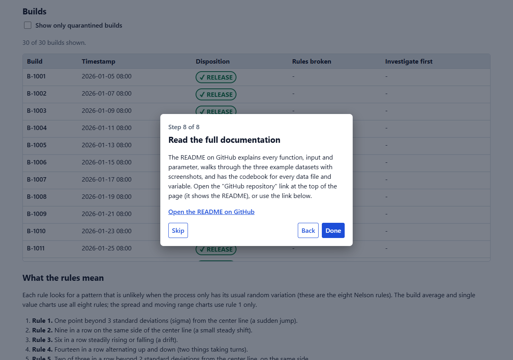
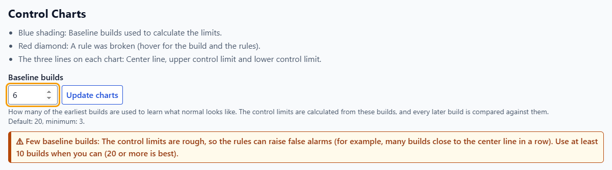
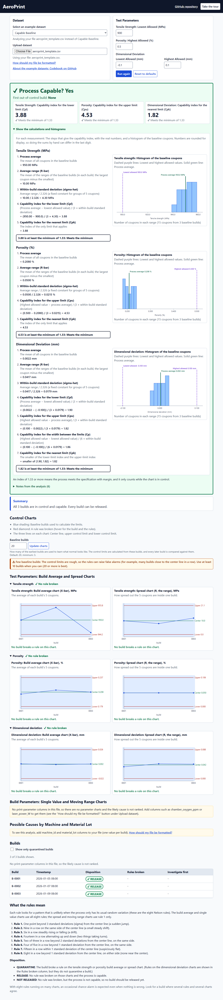
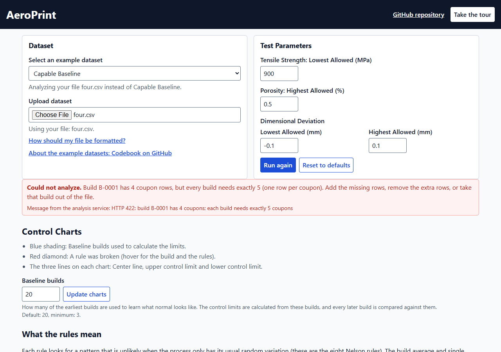
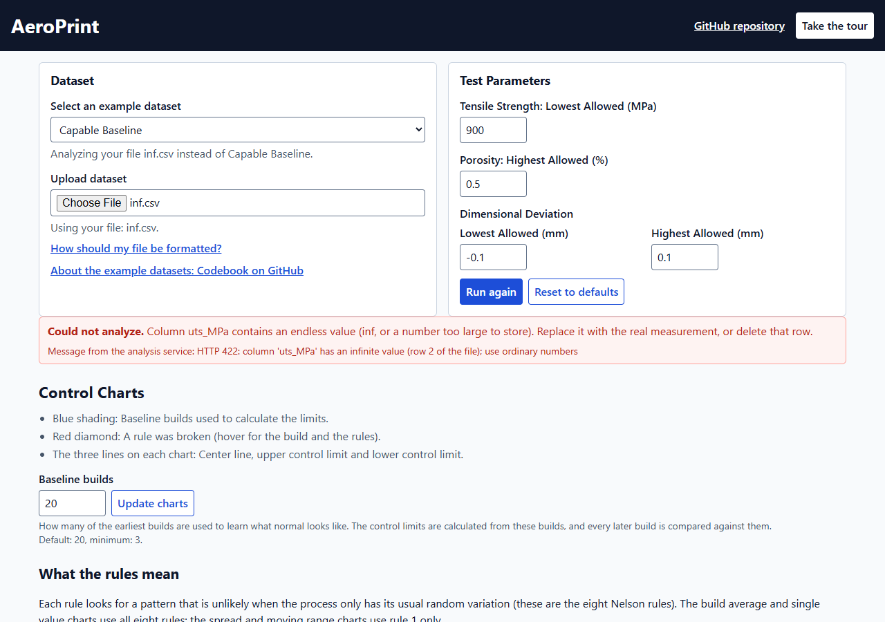
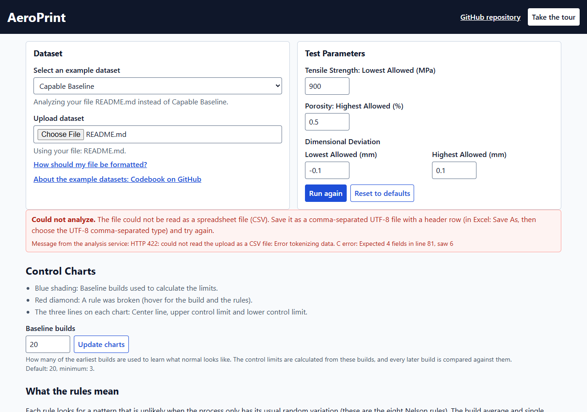

# AeroPrint demonstration walkthrough

**What you are about to see.** AeroPrint is for the supplier quality engineer who signs off each
build of 3D-printed titanium brackets after its 5 witness coupons come back from testing (and for
the process engineer who tunes the printer). It answers three questions: is the print process
capable of meeting the allowed values, which builds should be released or quarantined, and which
print setting, machine or powder lot is most likely linked to a problem.

Every number below was read from the running tool (the analysis service and the dashboard) while these
screenshots were taken. All three datasets are invented; see the codebook [`../data/README.md`](../data/README.md).

## Contents

1. [The 2-minute path](#1-the-2-minute-path)
2. [The guided tour](#2-the-guided-tour)
3. [The three datasets at a glance](#3-the-three-datasets-at-a-glance)
4. [Dataset 1: capable_baseline (the good case)](#4-dataset-1-capable_baseline-the-good-case)
5. [Dataset 2: oxygen_drift (a slow drift)](#5-dataset-2-oxygen_drift-a-slow-drift)
6. [Dataset 3: marginal_spread (in control, but not capable)](#6-dataset-3-marginal_spread-in-control-but-not-capable)
7. [Try your own data](#7-try-your-own-data)
8. [Change the allowed values](#8-change-the-allowed-values)
9. [The API in 3 curl examples](#9-the-api-in-3-curl-examples)
10. [What each number means](#10-what-each-number-means)
11. [Rebuild the screenshots](#11-rebuild-the-screenshots)

## 1. The 2-minute path

1. Open the live dashboard: <https://connect.systems-apps.com/content/a5702adb-d4c3-4cbc-8856-737753cfd9d2/>
   (the interactive API documentation is at <https://connect.systems-apps.com/content/8ec33f65-f84a-4323-a51d-b2d9a70e08da/docs>).
2. Press **Take the tour** (top right) and click through the 8 steps.
3. In **Select an example dataset** pick, one after the other, Capable Baseline, Oxygen Drift and Marginal Spread.
   Look at the top box ("Process Capable?"), then scroll to the charts and the Builds table.
4. Open the section **Possible Causes by Machine and Material Lot** on Marginal Spread.

**Run it on your own computer instead** (from the repo root, two terminals; Node 20 or newer is needed for the page):

```bash
# terminal 1: the API on http://localhost:8000  (docs at http://localhost:8000/docs)
bash app/testme.sh

# terminal 2: the dashboard on http://localhost:5173
cd app/frontend
npm install        # first time only
npm run dev
```

## 2. The guided tour

The tour opens by itself on a first visit; press **Take the tour** to open it again, **Skip** or Escape to close it.
It has 8 steps: What AeroPrint is for, Pick your data, Read the banner, See the calculations, Find the red
diamonds, Look for possible causes, Act on each build, and Read the full documentation. A step with a target
scrolls to that part of the page and outlines it.


*Step 1: who the tool is for and what it decides.*


*Step 8: the link to the README on GitHub.*

## 3. The three datasets at a glance

Limits come from the first 20 builds (B-1001 to B-1020). "Not reliable" means the chart is out of control, so the index
is shown greyed out and does not count. A process is capable only if every chart is in control and every index is at least 1.33.

| Dataset | Process capable? | Tensile strength Cpl | Porosity Cpu | Dimensional Cpk | First out-of-control build | Build dispositions |
|---|---|---|---|---|---|---|
| `capable_baseline` | Yes | 4.81 | 3.70 | 1.79 | none | 30 RELEASE |
| `oxygen_drift` | No | 4.64 (not reliable) | 3.51 (not reliable) | 1.42 | B-1023 | 8 QUARANTINE (B-1023 to B-1030), 22 NOT RELEASED |
| `marginal_spread` | No | 4.81 | 3.70 | **1.04** (below 1.33) | none | **30 NOT RELEASED** (no build is released) |

The three words for a build are: **QUARANTINE** (a rule was broken on the tensile strength or porosity charts),
**NOT RELEASED** (no rule was broken, but the process is not capable) and **RELEASE** (no rule was broken and the
process is capable).

## 4. Dataset 1: capable_baseline (the good case)

Choose **Capable Baseline** (it is the default).

- The banner reads "Process Capable? Yes" and "First out-of-control build: None".
- The three index boxes read: "Tensile Strength: Capability index for the lower limit (Cpl)" 4.81, "Porosity: Capability index for the upper limit (Cpu)" 3.70 and "Dimensional Deviation: Capability index for the nearest limit (Cpk)" 1.79. Each says "Meets the minimum of 1.33".
- The summary reads "All 30 builds are in control and capable. Every build can be released." No red diamond on any chart, and all 30 builds are RELEASE.


*The whole page for capable_baseline.*

The same page on a phone (375 px wide): [`capable_baseline_375px.png`](screenshots/capable_baseline_375px.png).

What to look for: nothing is red, and every index is above 1.33 while the charts are in control.

## 5. Dataset 2: oxygen_drift (a slow drift)

Choose **Oxygen Drift**. From build 21 the chamber oxygen creeps up, tensile strength falls and porosity rises.

- The banner reads "Process Capable? No" and "First out-of-control build: B-1023".
- Under the tensile strength index (4.64) and the porosity index (3.51) it says "Chart out of control", and the numbers are greyed. They are printed, but they do not count. The dimensional index 1.42 is reliable and "Meets the minimum of 1.33".
- The summary reads "From build B-1023 the process went out of control; 8 builds should be quarantined. Most likely cause: Chamber oxygen (ppm)."
- On the charts, builds that broke a rule are red diamonds (hover over one for the build and the rules). The chamber oxygen chart climbs from B-1022 on, before the first quality alarm.


*The whole page for oxygen_drift. Phone width: [`oxygen_drift_375px.png`](screenshots/oxygen_drift_375px.png).*

**The Builds table.** Scroll to the Builds table.


*B-1021 and B-1022 are NOT RELEASED (no rule broke, but the process is not capable). B-1023 onward are QUARANTINE, each with the rules broken written in words and "chamber oxygen (ppm): 9.4 standard deviations above the center line" (B-1023) in "Investigate first".*

- The table is greyed and a note above it reads: "The process is not capable, so no build should be released yet. The table is greyed out, and those builds show as NOT RELEASED."
- 22 builds are NOT RELEASED and 8 are QUARANTINE. A quarantine is never hidden by the capability decision.
- "Investigate first" ranks the print settings that broke a rule at that build. For every quarantined build chamber oxygen is first: 9.4 standard deviations above the center line at B-1023 and 52.3 at B-1030.
- Tick "Show only quarantined builds" to list only the 8 quarantined rows.

**Change the number of baseline builds.** The limits are learned from the earliest builds. In the Control Charts section,
type 10 in "Baseline builds" and press Enter (or press "Update charts"). The limits now use builds 1 to 10,
the first out-of-control build becomes **B-1022** (a porosity range chart alarm), and 9 builds are quarantined (B-1022 to B-1030).
If you type fewer than 10 builds, a caution appears:


*Typing 6 and pressing Enter (here on capable_baseline) shows "Few baseline builds: The control limits are rough, so the rules can raise false alarms ...". With 6 baseline builds, capable_baseline raises a first alarm at B-1006: a chance alarm.*

What to look for: the oxygen chart starts to drift first, so check the chamber oxygen before parts fall below 900 MPa
(the lowest tensile build average is 934.0 MPa at B-1030).

## 6. Dataset 3: marginal_spread (in control, but not capable)

Choose **Marginal Spread**. Tensile strength and porosity are the same as in capable_baseline.
The dimensional deviation scatters more, and machine AM-02 prints 0.025 mm higher (a disclosed, planted effect).


*"Process Capable? No", the first out-of-control build is None. The dimensional box shows 1.04 with "Below the minimum of 1.33: Not capable", with a thicker border and a warning sign (not colour alone).*

- Every chart is in control: no rule is broken and there is no red diamond.
- The summary reads "No build broke a rule, but Dimensional deviation is below the minimum of 1.33, so the process is not shown to be capable."
- **All 30 builds are NOT RELEASED.** No build is released, because the process is not capable. The API says NOT RELEASED itself, so the dashboard and the API agree.


*The whole page. Phone width: [`marginal_spread_375px.png`](screenshots/marginal_spread_375px.png).*

**How the index is computed.** The box "Show the calculations and histograms" is open by default. For Dimensional Deviation (mm) it shows:
process average 0.0131 mm; average range (R-bar) 0.0647 mm; within-build standard deviation (sigma-hat) = 0.0647 / 2.326 = 0.0278 mm;
Cpl = (0.0131 - (-0.100)) / (3 x 0.0278) = 1.36; Cpu = (0.100 - 0.0131) / (3 x 0.0278) = 1.04; Cp = (0.100 - (-0.100)) / (6 x 0.0278) = 1.20;
Cpk = the smaller of 1.36 and 1.04 = 1.04, which is below 1.33. The process is wide for the 0.10 mm limit and is sitting
closer to the upper limit.


*The calculations box (shown here for capable_baseline): each step, with the real numbers, next to a histogram. The solid green line is the process average and the dashed purple lines are the allowed values.
Phone width: [`calculations_toggle_375px.png`](screenshots/calculations_toggle_375px.png).*

**Possible Causes by Machine and Material Lot.** This section compares build averages by machine and by powder lot (a two-way ANOVA, an analysis of variance).
The section opens the measurement where it found a difference: Dimensional deviation shows "Difference found" and the others show "No difference found".


*The whole section. "Read this first" comes before the result. Phone width: [`possible_causes_375px.png`](screenshots/possible_causes_375px.png).*


*The interaction plot: one line per machine across the three powder lots. The lines are far apart and roughly parallel, so the machine
effect is the same in every lot.*

- The sentence reads "Machine AM-02 averages higher than AM-01 by 0.0176 mm (p-value 0.0015)."
- The ANOVA table: machine F ratio 12.77, p-value 0.0015, "Likely a real difference"; material lot p-value 0.8806 and machine x lot interaction p-value 0.9186, both "No evidence of a difference".
- Machine averages (build averages): AM-01 0.0037 mm, AM-02 0.0214 mm.
- **This is an association, not a cause.** Machine and lot are not randomised: the machine changes every 5 builds and the lot every 10, so a difference could be a time effect. 9 tests are run at the 0.05 level with no correction, so about 1 false alarm in 20 is expected by chance. The page says so under "Read this first".
- **Why a planted effect?** Real data would not tell us the right answer. We added +0.025 mm to every dimensional coupon printed on AM-02, so the analysis has a known thing to find. The size was chosen after a scan, to be large enough to detect with 5 builds per combination and small enough to raise no control chart alarm. This is disclosed in the codebook.

What to look for: a stable process can still fail the client's limit. The index tells you the spread is the problem, and the
Possible Causes section points at a machine to look at first (and nothing in the other measurements).

## 7. Try your own data

Use "Upload dataset" and pick a CSV file. A template is in [`../data/template/`](../data/template/); the full format is in [`../docs/csv-format.md`](../docs/csv-format.md).
Press "How should my file be formatted?" under the upload box to see the format in a window.


*The "Spreadsheet file (CSV) format" window. Phone width: [`csv_help_panel_375px.png`](screenshots/csv_help_panel_375px.png).*

- **Minimal file.** Upload `data/template/aeroprint_template.csv` (5 columns, 3 builds). The tensile strength Cpl is 3.88 (3.877 by hand), the porosity Cpu 4.53 and the dimensional Cpk 1.82. There are no parameter charts and the page says "No print-parameter columns in this file, so there are no parameter charts and the likely cause is not ranked." The few-builds caution shows too. `aeroprint_template_with_parameters.csv` adds the 8 parameter charts.


*The result for the 5-column template.*

**Friendly errors.** A bad file never crashes the page. A plain-words hint comes first and the raw message from the service stays visible under it.


*A file where build B-0001 has 4 coupons: "Build B-0001 has 4 coupon rows, but every build needs exactly 5 (one row per coupon). Add the missing rows, remove the extra rows, or take that build out of the file."*


*A file with `inf` as a tensile strength: "Column uts_MPa contains an endless value (inf, or a number too large to store). Replace it with the real measurement, or delete that row."*


*A file that is not a spreadsheet (here a text document): "The file could not be read as a spreadsheet file (CSV). Save it as a comma-separated UTF-8 file with a header row ..." The service answered with HTTP 422.*

## 8. Change the allowed values

The box **Test Parameters** holds four allowed values: "Tensile Strength: Lowest Allowed (MPa)" (900), "Porosity: Highest Allowed (%)" (0.5),
and Dimensional Deviation "Lowest Allowed (mm)" (-0.1) and "Highest Allowed (mm)" (0.1). These are assumptions, not measured values.

Example: choose Oxygen Drift, change the tensile strength lowest allowed value from 900 to 990, press **Run again**.
The tensile strength Cpl becomes -1.04 (still greyed, because the chart is out of control): the process average is below the new limit.
Press **Reset to defaults** to put the four values and the Baseline builds (back to 20) as they were.
If the dimensional lowest allowed value is not below the highest, the page says so and sends nothing.

## 9. The API in 3 curl examples

Start the API first (`bash app/testme.sh`, port 8000). The full list of endpoints is on the `/docs` page.

**1. List the example datasets.**

```bash
curl -s http://localhost:8000/datasets
```

```json
{"datasets":[{"name":"capable_baseline","description":"Capable baseline: A healthy process in control. ..."},
             {"name":"oxygen_drift","description":"Oxygen drift: Chamber oxygen creeps up from build 21. ..."},
             {"name":"marginal_spread","description":"Marginal spread: In control on every build but not capable, ... (machine AM-02 runs higher)."}]}
```

**2. Analyze an example dataset with 10 baseline builds.**

```bash
curl -s "http://localhost:8000/analyze/oxygen_drift?baseline_n=10"
```

Part of the answer (rounded, trimmed): `process_capable` is `false`, `first_out_of_control_build` is `"B-1022"`, `capability.uts_MPa.cpl` is 4.492 with `reliable` false,
`capability.dimensional_dev_mm.cpk` is 1.341 with `reliable` true, and the build for B-1023 is

```json
{"build_id": "B-1023", "disposition": "QUARANTINE",
 "rules_broken": ["uts X-bar rule 1", "uts X-bar rule 5", "porosity X-bar rule 1", "porosity X-bar rule 5"],
 "investigate_first": [{"parameter": "chamber_oxygen_ppm", "z": 9.81, "rules": [1, 5]}]}
```

**3. Analyze your own file** (the 3-build template):

```bash
curl -s -F file=@data/template/aeroprint_template.csv http://localhost:8000/analyze
```

Part of the answer: `process_capable` is `true`, `capability.uts_MPa.cpl` is 3.8767 (`reliable` true), the three builds are `RELEASE`, and
`warnings` says "few baseline builds (3): the control limits are rough, so the rules can raise false alarms; use at least 10 builds when you can (20 or more is best)".

Other endpoints: `GET /health` (answers `{"status":"ok"}`) and `GET /spec-limits` (the default allowed values).

## 10. What each number means

| Number | In plain words | How it is made |
|---|---|---|
| Process average (X-double-bar) | The typical value of the measurement across the baseline builds | Mean of the build averages |
| R-bar (average range) | The typical scatter inside one build | Mean of (largest coupon minus smallest coupon) over the baseline builds |
| sigma-hat | The within-build standard deviation | R-bar / 2.326 (2.326 is a fixed constant for groups of 5) |
| Cpl | How far the average is above the lowest allowed value, in units of 3 sigma-hat (used for tensile strength) | (process average - lowest allowed) / (3 x sigma-hat) |
| Cpu | How far the average is below the highest allowed value, in units of 3 sigma-hat (used for porosity) | (highest allowed - process average) / (3 x sigma-hat) |
| Cp | How wide the allowed band is compared with the spread (dimensional deviation only) | (highest allowed - lowest allowed) / (6 x sigma-hat) |
| Cpk | The worse of the two sides | The smaller of Cpl and Cpu |
| Minimum 1.33 | The least a capable process may have | Fixed in the tool |
| Control limits (upper and lower) | The band in which a build average should fall by chance alone | Process average +/- 0.577 x R-bar (build average chart); upper limit 2.114 x R-bar (range chart) |
| Red diamond | A build that broke a run rule (the 8 Nelson rules) | See the "What the rules mean" section on the page |
| Investigate first | Print settings that broke a rule at that build, biggest first | Distance from the center line in standard deviations |
| p-value | How likely a difference this big is by chance alone; small means a likely real difference | F test in the ANOVA; the cut-off used is 0.05 |

## 11. Rebuild the screenshots

The screenshots were taken with Playwright (a browser automation tool; it is not part of the app) against a build of the page
pointed at a local API. From the repo root:

```bash
# 1. API: .venv/Scripts/python.exe -m uvicorn app.main:app --port 8010
# 2. page:  cd app/frontend && VITE_API_BASE=http://localhost:8010 npx vite build --outDir <a folder outside the repo>
#           then serve that folder with: npx vite preview --outDir <that folder> --port 4181
# 3. in a scratch folder outside the repo: npm init -y && npm i playwright, then open http://localhost:4181,
#    choose the dataset in #dataset and call page.screenshot({ path: ..., fullPage: true }).
#    The tour opens on a first visit: press Escape, or set localStorage "aeroprint-tour-seen" to "1" before loading.
#    Phone width is a viewport of 375 x 800 pixels.
```
